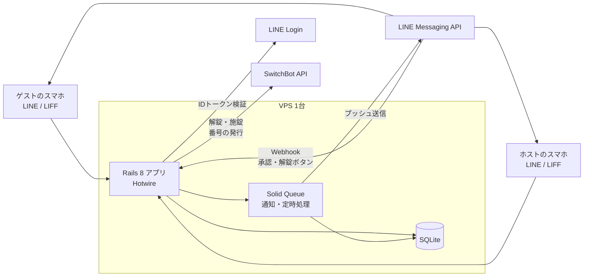
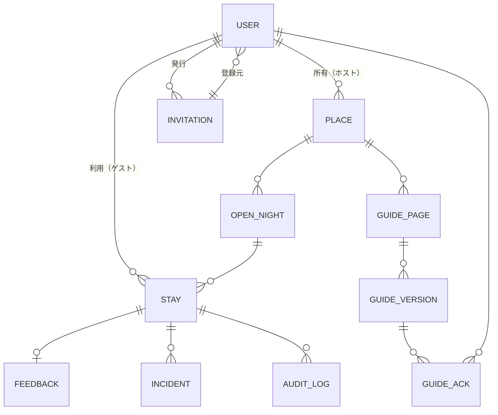
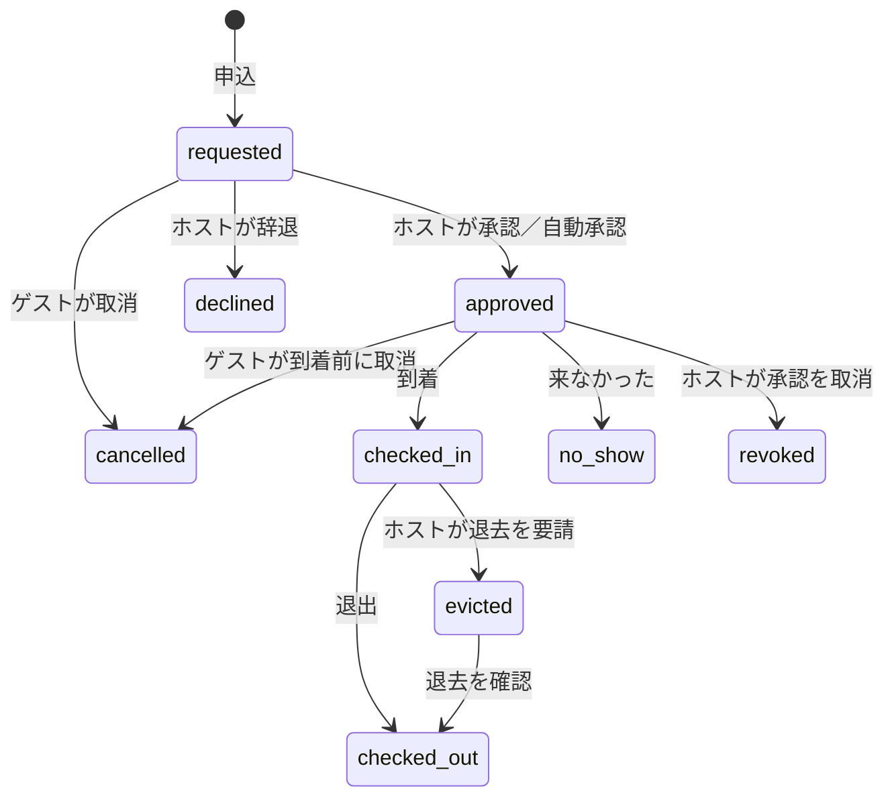

# 03. システム設計

対象はステージ0。利用者は数十人以下、同時利用は数人という規模を前提に、1 台構成で安く運用できることを優先する。

## 1. 方針

- **Web アプリ 1 本**。ゲストもホストも LINE 内のブラウザ（LIFF）から開く。ネイティブアプリは作らない。
- **認証は LINE ログインのみ**。パスワードを持たない。
- **通知は LINE 公式アカウントからのプッシュ**。
- **サーバーは Rails のモノリス 1 台**。DB・ジョブ・キャッシュを同居させる。
- **鍵は差し替え可能な部品として扱う**。機種が決まっていなくても他の部分を作れるようにする。
- **ホストの決定は常に最優先**。ゲスト側のどの状態からでも、ホストは取消・退去要請・利用停止に移せる。

## 2. 構成

| 要素 | 採用 | 理由 |
|---|---|---|
| アプリ | Ruby on Rails 8 + Hotwire | サーバー描画で画面数が少なく済む。開発者の既存の経験を活かせる |
| DB | SQLite | 規模が小さく、1 台で完結し、バックアップがファイルコピーで済む |
| ジョブ | Solid Queue | 追加のミドルウェアなしで通知・定時処理ができる |
| 画面 | LIFF（LINE 内ブラウザ） | インストール不要、ログイン操作なし |
| 通知 | LINE Messaging API | ゲストが必ず見る。ボタン付きメッセージを送れる |
| 鍵 | SwitchBot（ロック ＋ キーパッド ＋ ハブ） | 6 章、04-lock-selection.md |
| 配置 | 小型 VPS 1 台 + Kamal | 月数百円〜1,000 円程度 |

LINE Messaging API の無料枠には月間の送信数上限がある（契約前に現行の上限を確認する）。Webhook への応答メッセージは上限に数えられないため、可能な箇所は応答で返す。全ゲストへの一斉通知（F-13）は人数分を消費するので、ゲストが増えたら見直す。

ホストが複数になり同時書き込みが増えたら、DB を PostgreSQL に替える。

## 3. データモデル

| テーブル | 主な項目 |
|---|---|
| users | line_user_id（一意）, line_display_name, line_picture_url, nickname, role（host / guest）, status（active / suspended / withdrawn）, invitation_id, trusted_at, trusted_by |
| invitations | token（一意）, kind（single / group）, label, max_uses, used_count, expires_at, status（active / disabled）, issued_by |
| blocks | line_user_id（一意）, blocked_by, blocked_at, memo |
| places | host_id, name, address, lat, lng, entry_method（pin / remote / both）, lock_adapter, lock_config（暗号化）, smoking_policy（no_smoking / e_cig_only / outdoor_only）, default_sleep_slots, has_shower, auto_approve_default, auto_approve_only_when_empty, trusted_accept_until |
| open_nights | place_id, night_on（営業日）, accept_from, accept_until, ends_at（翌 10:00）, sleep_slots, shower_available, auto_approve, status（open / closed / ended）, host_memo |
| stays | open_night_id, guest_id, wants_sleep, wants_shower, eta, pickup_eta（空なら朝まで）, note, status, approved_by（host / auto）, shower_state（none / using / done）, access_code（暗号化）, 各状態の時刻 |
| guide_pages | place_id, title, position, topic（smoking / sleep / shower / toilet / rules / entry / other）, requires_ack, visibility（registered / approved_tonight）, draft_body, published_version_id, archived_at |
| guide_versions | guide_page_id, number, body, smoking_policy（喫煙ページのみ）, important, published_by, published_at |
| guide_acks | guide_version_id, user_id, kind（viewed / agreed）, occurred_at |
| incidents | stay_id, kind（smoking / other）, body, 写真（添付）, created_at |
| feedbacks | stay_id, helped（はい / いいえ）, comment |
| audit_logs | occurred_at, actor_id, action, stay_id, open_night_id, target_user_id, detail |

設計上の注意点：

- **営業日**：滞在が翌朝 10:00 まで続くため、`night_on` は「正午で切り替わる日付」とする。金曜 23:00 の申込も土曜 9:00 の退出も、金曜の夜に属する。
- **受付と滞在を分ける**：`accept_until`（新規申込の締切）と `ends_at`（滞在の終了）は別の項目にする。
- **利用停止を users から分ける**：`blocks` は LINE 識別子で持ち、ユーザーが登録解除しても残す。登録時に必ず照合する（F-53）。
- **audit_logs は追記のみ**：アプリから更新・削除する経路を作らない。DB のトリガーでも UPDATE / DELETE を拒否する（F-60）。
- **一意制約**：`open_nights(place_id, night_on)`、および同じ夜に同じゲストの有効な stay は 1 件まで。
- **places を独立させる**：ステージ0 は 1 件だけだが、ホスト拡大時に構造を変えずに済む。

## 4. 利用（stay）の状態遷移

- **定員の管理**：承認時に、同じ夜の `approved`・`checked_in` のうち寝床希望の件数を数え、`sleep_slots` 未満のときだけ承認する。数える処理と更新は 1 つのトランザクションで行う。シャワーのみの利用は寝床の定員に数えない。
- **ホストによる遷移**（`revoked`・`evicted`、利用停止に伴う取消）は、理由の入力を求めず、1 回の確認だけで実行する。実行と同時に、案内画面の非表示、利用ごとの暗証番号の無効化、ゲストへの通知、監査ログへの記録を行う。
- **利用停止**：`users.status` を `suspended` にし、`blocks` に追加し、そのゲストの進行中の stay を状態に応じて `declined`・`revoked`・`evicted` にする。
- **朝の処理**：9:30 に滞在中のゲストへ通知、10:00 に残っているゲストをホストへ通知する。10:00 を過ぎても自動では退出扱いにせず、ホストが退出を確認して記録する。正午に、その夜を `ended` にし、`requested` のままの申込を `declined` にする。

### 自動承認

申込を保存した直後に、次の判定を承認と同じトランザクションの中で行う。

1. ゲストが信頼済み（`users.trusted_at` が入っている）で、利用停止でない
2. その夜の `open_nights.auto_approve` が有効
3. 現在時刻が受付時間内（信頼済み向けの締切 `trusted_accept_until` があればそれを使う）
4. 寝床希望の場合、定員に空きがある
5. 同意が必要なガイドに、再同意の必要がない（7 章）
6. 場所の入り方に暗証番号が含まれる（`entry_method` が `pin` または `both`）
7. `auto_approve_only_when_empty` が有効な場合、同じ夜に `approved`・`checked_in` の利用がほかにない

すべて満たせば `approved`・`approved_by = auto` にして、ホストによる承認と同じ後続処理（ゲストへの通知）を行う。1 つでも満たさなければ `requested` のまま残し、通常の申込としてホストに通知する。どの条件で外れたかは監査ログに残す。

- **信頼済みの設定**はホストだけが行える。設定・解除は監査ログに残す。利用停止にすると自動で解除する。
- **ホストへの通知**は、自動承認の場合は LINE の「通知音なし」の指定で送る。条件を満たさず承認待ちになった申込は、通常どおり音の鳴る通知で送る。
- **取消**は通常の承認と同じ。ホストが朝に確認して取り消すこともできる。
- 夜ごとのスイッチを切ると、以後の申込はすべてホストの承認待ちになる。すでに自動承認した利用には影響しない。

## 5. 招待と登録

1. ホストが管理画面で招待を作る。個別（1 回限り）か、グループ（ラベル・人数上限・期限つき）を選ぶ。
2. 画面に QR コードとリンクが出る。対面なら QR を見せ、離れていればリンクを LINE で送る。
3. 相手が開くと LINE 内で登録画面が開く。LINE の表示名とアイコンが入った状態で、同意が必要なガイド（ハウスルールなど）と「同意して登録」ボタンだけが出る。
4. ボタンを押すと、登録と公式アカウントの友だち追加が同時に済み、「今夜」画面に移る。

グループ招待は転送されうるので、次の歯止めを置く。

- 人数上限と有効期限を必須にする。
- 登録しただけでは住所は見えない。利用には毎回ホストの承認が要る。
- 申込通知に「初めての利用」「登録元の招待」を表示する。
- 招待を無効にでき、その招待から登録した全員をまとめて利用停止にできる（F-54）。

## 6. 鍵と入り方

鍵の操作は次の 5 つの操作を持つ部品（アダプター）にまとめ、機種ごとに実装を差し替える。

| 操作 | 内容 |
|---|---|
| 番号の発行 | その利用専用の、期限つき暗証番号を作る |
| 番号の無効化 | 発行した番号を使えなくする |
| 解錠 | 遠隔で鍵を開ける |
| 施錠 | 遠隔で鍵を閉める |
| 状態の取得 | 施錠されているかを調べる |

### 方式1：暗証番号

| 実装 | 動き | ホスト権限との関係 |
|---|---|---|
| 固定番号（API なし） | 全員共通の番号を場所の設定に保存し、承認済みゲストの案内画面に表示する | 取消・利用停止をしても相手は番号を知ったまま。ホストが鍵本体の番号を変える必要がある。システムは変更を促す通知を出す |
| 短命の番号（SwitchBot で採用） | ゲストが「着きました」を押すたびに、30 分だけ有効な番号を発行する。利用が `approved` または `checked_in` のときだけ発行する | 取消・利用停止の後は発行しない。発行済みの番号は最大 30 分で切れる。削除も呼び、番号一覧を読み直して消えていなければホストに通知する |

### 方式2：遠隔解錠

1. 番号で開かないとき、ゲストが案内画面で「ホストに開けてもらう」を押す。
2. ホストに「解錠」ボタン付きの通知が届く。
3. ホストが押すと、アダプターが解錠し、ゲストに通知する。
4. 解錠した日時と操作者を監査ログに残す。

解錠を操作できるのはホストだけとする。ホストが就寝中は応答できないので、深夜は方式1 が主、方式2 は初めてのゲストや番号が効かないときの手段になる。

### 推奨

ホストの権限を鍵にまで効かせるには、**利用ごとの番号を API で発行・無効化できる機種**が必要になる。鍵をこれから選ぶなら、次の点を満たすものを選ぶ。

- 暗証番号の入力装置があり、期限つき番号を API から発行・削除できる
- 遠隔での解錠・施錠と状態取得を API からできる
- 扉が閉まると自動で施錠される

候補の比較と推奨は [04-lock-selection.md](04-lock-selection.md) にまとめた。鍵は SwitchBot を前提とする。番号の削除が効かないという報告があるため、短命の番号で運用する（04 の 4 章）。番号が鍵に届くまで数秒〜数十秒かかる見込みなので、画面には「準備中」を出し、届いてから番号を表示する。

機種が決まるまでは、固定番号の実装と、手動（ホストが鍵メーカーのアプリで解錠し、システムには記録だけ残す）の実装で試行を始められる。

## 7. ガイドとハウスルール

寝具・シャワー・トイレの使い方、ハウスルール、入り方の説明は、すべて「ガイドのページ」として同じ仕組みで扱う。

### 編集

- 編集画面には Rails 標準のリッチテキスト機能（Action Text）を使う。見出し、太字、箇条書き、番号つきリスト、リンク、写真の挿入を、表示どおりの見た目で編集できる。スマホのブラウザでも動く。
- 写真は Active Storage でサーバーのディスクに保存し、表示用に縮小版を自動で作る。
- 本文は保存時に許可した要素だけを残す（スクリプトなどは除去する）。
- 編集内容は `draft_body` に自動保存する。ゲストに見えるのは公開済みの版だけ。
- 「プレビュー」で、ゲストの画面と同じ表示を確認できる。

### 公開と版

1. ホストが「公開」を押し、「重要な変更」かどうかを選ぶ。
2. `draft_body` の内容を新しい `guide_versions` として保存し、ページの `published_version_id` を付け替える。
3. 版は追記のみで、変更・削除しない。過去の版に戻すときは、その内容で新しい版を作る。
4. ページを削除するときは `archived_at` を入れて非表示にするだけで、版と同意の記録は残す。

### 周知と同意

| 場面 | 動き |
|---|---|
| 登録時 | `requires_ack` のページの最新版を表示し、「同意して登録」で `agreed` を記録する |
| 申込時 | `requires_ack` のページのうち、「重要な変更」を含む版が同意の後に公開されていれば、変更されたページを表示して再同意を求める。同意するまで申込できない |
| 承認時 | 通知に案内画面へのリンクを付ける。案内画面では、希望に合うページ（寝床なら `sleep`、シャワーなら `shower`）と `toilet`、`rules` を先に並べる |
| 滞在中 | 案内画面からいつでも読める。室内の QR コードから該当ページを直接開ける |
| 重要な変更の公開時 | 全ゲストに通知する。滞在中・承認済みのゲストには必ず通知する |

再同意が必要かどうかは、「ページごとに、そのゲストが最後に同意した版より後に `important` な版があるか」で判定する。軽微な修正（誤字など）では再同意を求めない。

ページを開いたら `viewed` を記録する。同意の記録には版を紐づけるので、「この人はこの文面に、この日時に同意した」と後から示せる。

### 喫煙ルール

喫煙ルールは、ガイドの仕組み（版・同意・再同意）に載せつつ、ホストが弱められない固定のページとして扱う。

- 場所ごとに `topic = smoking` のページを 1 つ、システムが必ず作る。`requires_ack` は常に有効、表示範囲は常に `registered`。ホストは削除・非表示・同意不要への変更ができない。
- ページの見出し部分は `places.smoking_policy` から自動で作る（選択肢ごとの定型文とアイコン、違反時の扱い、火災の危険）。ホストが編集できるのは、その下の補足だけ。

| 設定 | 表示する定型文 |
|---|---|
| `no_smoking` | 完全禁煙。室内・ベランダ・敷地内のどこでも、紙巻き・加熱式・電子タバコすべて不可 |
| `e_cig_only` | 加熱式・電子タバコのみ可。紙巻きたばこは不可 |
| `outdoor_only` | 喫煙はベランダ・屋外でのみ可。室内は不可 |

- `smoking_policy` を変えると、その値を写した新しい版を、必ず `important = true` で公開する。全ゲストへの通知と、次の申込前の再同意が自動で起きる。
- 同意は `guide_acks` に版つきで残るので、「この人は『完全禁煙』に、この日時に同意した」と示せる。
- `smoking_policy` が未設定の場所は、開放（`open_nights` の作成）を拒否する。
- 表示は共通の部品 1 つにまとめ、登録・今夜・申込・案内（到着前・滞在中）・ガイドのルールページの先頭に同じ見た目で出す。承認の通知には定型文を 1 行で入れる。
- 登録画面では、喫煙ルールへの同意と、ほかのガイドへの同意を、別々のボタンで取る。
- トラブル記録で `kind = smoking` を選ぶと、そのゲストの信頼済みを解除する。退去要請・利用停止は従来どおりホストが選ぶ。

### 表示の範囲

- `registered`：登録済みの全ゲストが読める。寝具・シャワー・トイレ・ハウスルールはこれを既定にし、来る前に読めるようにする。
- `approved_tonight`：承認されたゲストに、その夜だけ表示する。入り方の説明など、場所が分かる内容に使う。写真に外観や表札が写るページもこちらにする。

住所と暗証番号はガイドの本文に書かず、これまでどおり専用の項目で管理する（取消時に確実に隠すため）。

## 8. 画面

| 画面 | 利用者 | 内容 |
|---|---|---|
| 招待の受け取り | 未登録者 | 同意が必要なガイド、「同意して登録」ボタン |
| ガイド | ゲスト | 使い方・ハウスルールのページ一覧と本文。再同意が必要なときは同意ボタン |
| 今夜 | ゲスト | 開放状況、残りの寝床数、申込ボタン。申込後は自分の利用の状態 |
| 申込 | ゲスト | 到着予定（今すぐ / 30 分後 / 1 時間後）、希望、代行の見込み（1 時間後 / 2 時間後 / 朝まで）、メモ |
| 案内 | ゲスト（承認後） | 住所、地図アプリへのリンク、「着きました」ボタン、30 分有効の暗証番号と残り時間、「ホストに開けてもらう」ボタン、ガイド（希望に合うページを先に表示）、シャワー・退出ボタン |
| 今夜の管理 | ホスト | 開放の設定・締切・打ち切り、自動承認の切り替え、申込一覧と承認・辞退、滞在中のゲスト、解錠・施錠、承認取消・退去要請、負担メモ |
| ゲスト管理 | ホスト | 招待の発行（QR 表示）・無効化、ゲスト一覧、信頼済み（自動承認）の設定、利用停止、まとめて停止 |
| ガイド編集 | ホスト | 喫煙ルールの選択と補足、ページの追加・並べ替え、本文の編集（WYSIWYG）、プレビュー、公開、同意の要否と表示範囲の設定、過去の版、ゲストごとの既読・同意状況 |
| 記録 | ホスト | 利用一覧、月ごとの回数・平均滞在時間、アンケート結果、監査ログ、トラブル記録、書き出し |

ゲストの主経路は「今夜 → 申込 → 案内」の 3 画面。選択式にして文字入力をなくす。

取消・退去要請・利用停止を受けたゲストには、案内画面の代わりに「この利用は終了しました」とだけ表示する。理由は表示しない。

## 9. 通知

| きっかけ | 宛先 | 内容 |
|---|---|---|
| 開放を設定した | 全ゲスト | 今夜開放していること、受付時間 |
| 申込があった | ホスト | 申込内容、初回かどうか、登録元の招待、「承認」「辞退」ボタン |
| 承認・辞退した | ゲスト | 結果。承認時は喫煙ルール（1 行）、案内画面とガイドへのリンク |
| 自動承認した | ホスト | 誰を自動承認したか、申込内容、「取り消す」ボタン（通知音なし） |
| 自動承認の条件から外れた | ホスト | 通常の申込通知に、外れた理由を添える |
| ゲストが取り消した | ホスト | 誰が取り消したか |
| 「着きました」が押された | ホスト | 誰が着いたか（通知音なし） |
| 「ホストに開けてもらう」が押された | ホスト | 誰が待っているか、「解錠」ボタン |
| 解錠した | ゲスト | 鍵が開いたこと |
| 代行の到着見込みの 10 分前 | ゲスト | そろそろ代行が来る時刻であること |
| 退出した | ホスト | 誰が退出したか、残りの滞在者数 |
| 承認を取り消した | ゲスト | 利用できなくなったこと |
| 退去を要請した | ゲスト | すぐに退出してほしいこと |
| 開放を打ち切った | 滞在中・承認済みのゲスト | 今夜の開放が終了したこと |
| 9:30 | 滞在中のゲスト | 10:00 までに退出すること |
| 10:00 | ホスト | まだ滞在中のゲストの一覧 |
| ガイドの重要な変更を公開した | 全ゲスト | 変更したページ名とリンク。同意が必要なら次の申込時に再同意となること |
| 固定番号で運用中に取消・利用停止をした | ホスト | 鍵の番号を変更すること |
| 退出の当日夕方 | 利用したゲスト | 一言アンケートへのリンク |

通知には住所と暗証番号を書かない。どちらも案内画面でのみ表示する。

## 10. 認証と権限

- LIFF から受け取った ID トークンをサーバー側で LINE に検証し、`line_user_id` でユーザーを特定してセッションを発行する。
- 未登録の `line_user_id` は、有効な招待トークンがあり、かつ `blocks` に載っていないときだけ登録できる。
- リクエストのたびに `users.status` を確認する。利用停止は、相手がログイン中でも次の操作から効く。
- ホスト権限は、初期設定で登録した 1 つの `line_user_id` にだけ与える。画面から付与・変更する機能は作らない。
- 案内画面は、「本人の stay が `approved` または `checked_in`」かつ「その夜が終了していない」ときだけ表示する。
- 暗証番号と鍵の API 認証情報は暗号化して保存する。暗証番号を画面に出すたびに監査ログへ記録する。
- LINE の Webhook は署名を検証し、ボタンの操作者がその場所のホストであることを確認する。

| 操作 | ゲスト | ホスト |
|---|---|---|
| 申込、到着前の取消、到着・退出の記録 | 自分の分のみ | 全員分を代行可 |
| 承認、辞退、承認取消、退去要請 | 不可 | 可 |
| 信頼済みの設定、自動承認の切り替え | 不可 | 可 |
| 解錠・施錠 | 不可（暗証番号の入力のみ） | 可 |
| 利用停止、招待の発行・無効化 | 不可 | 可 |
| ガイドの閲覧・同意 | 表示範囲に応じて可 | 可 |
| ガイドの編集・公開 | 不可 | 可（公開済みの版の変更・削除は不可） |
| 監査ログ・トラブル記録の閲覧 | 不可 | 可（変更・削除は不可） |

## 11. 運用

- **バックアップ**：SQLite のファイルと、ガイド・トラブル記録の写真を 1 日 1 回、別の保管先へ複製する。
- **障害時**：開放時間中にシステムが使えないときは、LINE の直接のやり取りと、鍵メーカーのアプリによる解錠に切り替える。利用記録は後からホストが手入力できるようにする。
- **データの保持**：ゲストが登録解除しても、利用記録・監査ログ・利用停止の情報は保持する。この扱いは同意が必要なガイド（ハウスルール）に書き、同意を記録する。

## 12. 実装の順序（参考）

1. LINE ログイン、招待（QR・グループ）、登録、利用停止の照合
2. ガイドの編集・公開・同意
3. 開放設定、今夜の表示、申込、承認、案内（固定番号・手動解錠）
4. 到着・退出、通知、朝の処理、監査ログ
5. ホストの権限（承認取消、退去要請、利用停止、打ち切り）、記録一覧
6. 自動承認

ここまでで試行を開始できる。鍵の API 連携（利用ごとの番号、遠隔解錠ボタン）は機種が決まり次第、アダプターを追加する。
