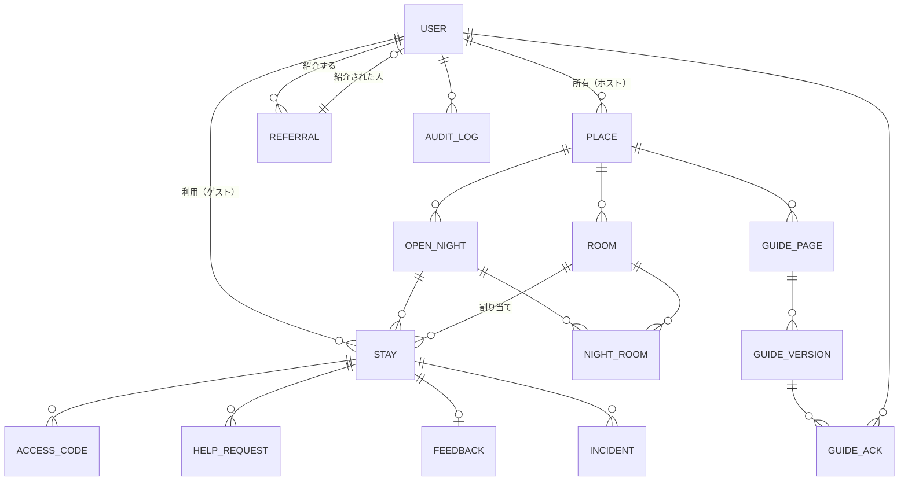
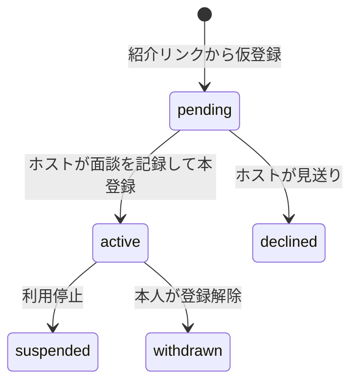
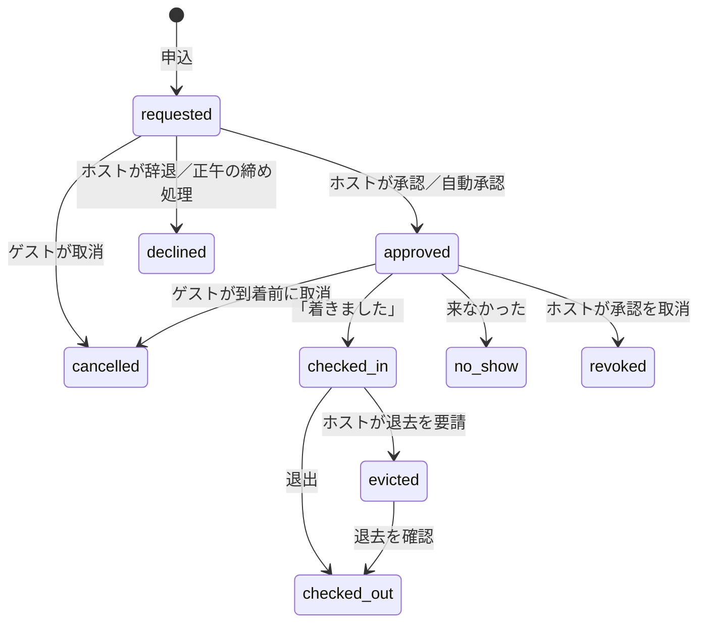
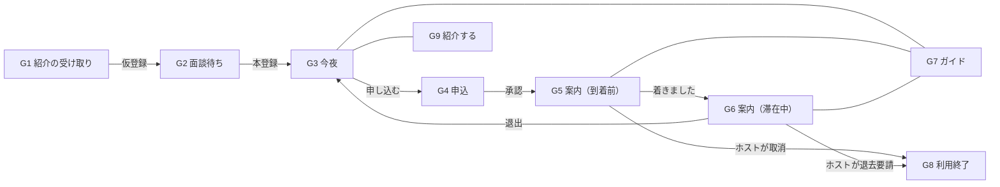

# 03. 設計書

| 項目 | 内容 |
|---|---|
| 版 | 1.1（2026-11-18）。1.0 からの変更点は 16 章 |
| 対象 | ステージ0：ホストの自宅 1 か所、完全紹介制、無償 |
| 関連文書 | [01 企画](01-concept.md)／[02 要件](02-requirements.md)／[04 鍵の選定](04-lock-selection.md)／[05 システム構成図](05-system-architecture.md)／[06 ホスティングの選定](06-hosting.md)／[07 トラブル対策の調査](07-trouble-prevention-review.md)／[08 組み込み方針とロードマップ](08-trouble-measures-roadmap.md)／[09 ハウスルール第 1 版の案](09-house-rules-v1.md) |

要件の ID（F-xx、N-xx）は 02 を指す。「仮」と書いた値は未確定で、13 章にまとめる。外部サービスの仕様のうち実機・公式資料で確かめていないものは 15 章にまとめる。

## 1. 概要と方針

飲み会のあと、代行が来るまで、または朝まで、ホストの自宅の寝床とシャワーを、紹介と面談を経たゲストに無償で開放するための Web システム。

- **Web アプリ 1 本**。ゲストもホストも LINE 内のブラウザ（LIFF）から開く。専用アプリは作らない。
- **認証は LINE ログインのみ**。パスワードを持たない。
- **通知は LINE 公式アカウント**から送る。
- **サーバーは 1 台**。アプリ・DB・ジョブを同居させ、月 1,000 円程度で運用する。
- **入口は紹介だけ**。ホストが対面で面談した人だけを本登録にする。
- **ホストの決定が常に最優先**。どの状態からでも、ホストは理由なしに取消・退去要請・利用停止ができる。
- **安全の出口を用意する**。利用の可否はホストが決めるが、ゲストがいつでも退出でき、助けを呼べる手段を、常に画面に出す。
- **ゲストの同宿の希望を守る**。同じ夜にほかのゲストがいてよいかは本人が決め、それに反する承認をシステムが止める。
- **証跡を残す**。同意・操作・鍵の発行を、変更できない形で記録する。
- **屋内の映像と音声を扱わない**。
- **鍵は部品として切り離す**。SwitchBot を前提にするが、アダプター 1 か所の差し替えで他機種に移れるようにする。

## 2. システム構成

全体の図と流れは [05 システム構成図](05-system-architecture.md) を参照。

| 要素 | 採用 | 補足 |
|---|---|---|
| アプリ | Ruby on Rails 8 ＋ Hotwire | サーバー描画。画面の一部更新に Turbo を使う |
| DB | SQLite | 1 台で完結。ホストが複数になり同時書き込みが増えたら PostgreSQL に替える |
| ジョブ | Solid Queue | 通知の送信、定時処理、鍵の操作 |
| リッチテキスト・写真 | Action Text ＋ Active Storage（サーバーのディスク） | ガイドの編集、トラブル記録の写真 |
| 画面の入口 | LIFF | LINE の中で開く |
| 認証 | LINE Login | ID トークンをサーバーで検証 |
| 通知 | LINE Messaging API | プッシュ、ボタンつきメッセージ、Webhook |
| 鍵 | SwitchBot ロック ＋ キーパッド ＋ ハブ | クラウド API 経由。04 を参照 |
| サーバー | KAGOYA CLOUD VPS（メモリ 1GB） | 06 を参照 |
| 配置 | Kamal（Docker コンテナ 1 つ ＋ Kamal Proxy） | HTTPS の証明書は自動取得 |
| URL | 独自ドメインを推奨 | LIFF と Webhook は正規の証明書つき HTTPS が必須 |
| バックアップ先 | オブジェクトストレージ | DB と写真を 1 日 1 回 |
| 死活監視 | 外部の監視サービス | 停止時にホストへ知らせる |

## 3. 利用者と権限

| 利用者 | 説明 |
|---|---|
| ホスト | 自宅を開放する人。1 名。初期設定で登録した LINE アカウント 1 つだけに権限を与え、画面からは付与・変更できない |
| ゲスト | 紹介を受け、面談を経て本登録された人 |
| 仮登録の人 | 紹介リンクから仮登録し、面談を待っている人。面談待ちの画面しか開けない |

| 操作 | 仮登録の人 | ゲスト | ホスト |
|---|---|---|---|
| ガイドへの同意（面談時） | 可 | 可（再同意） | — |
| 開放状況・ガイドの閲覧 | 不可 | 可（ページの表示範囲による） | 可 |
| 申込、到着前の取消、到着・退出の記録 | 不可 | 自分の分のみ | 全員分を代行可 |
| 同宿の希望の選択と変更 | 面談の画面で選ぶ | 自分の分のみ（6.11 の範囲で） | — |
| 暗証番号の受け取り | 不可 | 承認済み・滞在中のみ | — |
| 「困っています」の送信 | 不可 | 承認済み・滞在中のみ | — |
| 紹介リンクの発行 | 不可 | ホストが許可したゲストのみ | 可 |
| 面談の記録、本登録、見送り | 不可 | 不可 | 可 |
| 性別の登録、紹介の可否・信頼済みの設定 | 不可 | 不可 | 可 |
| 承認、辞退、部屋の割り当てと変更 | 不可 | 不可 | 可（6.11 の決まりの範囲で） |
| 承認取消、退去要請、利用停止、注意 | 不可 | 不可 | 可 |
| 開放の設定・締切・打ち切り、自動承認の切り替え | 不可 | 不可 | 可 |
| 場所の設定（部屋、連絡先、説明） | 不可 | 不可 | 可 |
| 解錠・施錠、鍵の状態確認 | 不可 | 不可 | 可 |
| ガイドの編集・公開、喫煙ルールの設定 | 不可 | 不可 | 可（公開済みの版は変更・削除不可） |
| 記録・監査ログ・面談メモの閲覧 | 不可 | 不可 | 可（監査ログは変更・削除不可） |

## 4. データ設計

### 4.1 全体

共通：全テーブルに `id`、`created_at`、`updated_at` を持つ。時刻は UTC で保存し、表示は日本時間。

### 4.2 users（利用者）

| 項目 | 型 | 内容 |
|---|---|---|
| line_user_id | 文字列・一意 | LINE のユーザー識別子 |
| line_display_name | 文字列 | LINE の表示名（ログインのたびに更新） |
| line_picture_url | 文字列 | LINE のアイコン |
| nickname | 文字列 | 呼び名。初期値は LINE の表示名 |
| role | host / guest | |
| status | pending / active / declined / suspended / withdrawn | 5.1 |
| gender | female / male / unspecified | 性別。面談でホストが登録する。同宿の配慮にだけ使う（F-130） |
| others_pref | alone / same_gender / anyone・既定は same_gender | 同宿の希望の既定値（6.11） |
| referrer_id | users への参照 | 紹介者。ホスト自身が紹介した場合はホスト |
| can_refer | 真偽・既定は偽 | 紹介できるか。ホストが設定（F-02a） |
| interviewed_at | 日付 | 面談した日 |
| interviewed_by | users への参照 | 面談したホスト（F-170） |
| interview_checklist | JSON | 説明した項目のチェック |
| interview_memo | 文字列（暗号化） | 本名・連絡先など。ホストだけが読める |
| trusted_at / trusted_by | 日時 / 参照 | 信頼済み（自動承認の対象）。空なら対象外 |

### 4.3 referrals（紹介リンク）

| 項目 | 型 | 内容 |
|---|---|---|
| token | 文字列・一意 | 推測できない長さの乱数 |
| referrer_id | 参照 | 発行者 |
| candidate_user_id | 参照（空可） | 仮登録した人 |
| status | issued / used / expired / disabled | |
| expires_at / used_at | 日時 | 有効期限は発行から 7 日（仮） |

### 4.4 blocks（利用停止の名簿）

| 項目 | 型 | 内容 |
|---|---|---|
| line_user_id | 文字列・一意 | 停止した LINE アカウント |
| blocked_by / blocked_at | 参照 / 日時 | |
| memo | 文字列 | ホストのメモ |

users と分けて持ち、本人が登録解除しても残す。仮登録のたびに照合する（F-53）。

### 4.5 places（場所）

| 項目 | 型 | 内容 |
|---|---|---|
| host_id | 参照 | |
| name / address / lat / lng | | 住所は承認済みのゲストにだけ表示 |
| layout_note | 文字列・必須 | 部屋の仕切りと共用部分の説明。未設定では開放できない（F-184） |
| emergency_phone | 文字列（空可） | ホストの緊急用の電話番号。承認済み・滞在中のゲストに表示（F-121） |
| refuge_note | 文字列（空可） | 夜間に移れる場所 |
| third_party_contact | 文字列（空可） | ホスト以外の相談先（名前と連絡の方法） |
| lock_adapter | switchbot / manual | manual は連携なし（ホストが手で開ける） |
| lock_config | JSON（暗号化） | SwitchBot のトークン、ロックとキーパッドの機器 ID |
| code_ttl_minutes | 整数・既定 30 | 暗証番号の有効時間 |
| smoking_policy | no_smoking / e_cig_only / outdoor_only | 未設定では開放できない（F-100） |
| has_shower | 真偽 | 開放設定の初期値 |
| default_accept_from / default_accept_until | 時刻 | 受付時間の初期値（仮：21:00〜翌 3:00） |
| trusted_accept_until | 時刻（空可） | 信頼済みゲスト向けの締切（F-98） |
| auto_approve_default | 真偽 | 自動承認の初期値 |
| auto_approve_only_when_empty | 真偽・既定は真 | ほかに滞在者がいるときは自動承認しない（F-97） |
| max_active_referrals | 整数（仮：2） | ゲスト 1 人が同時に持てる紹介リンク数（F-02c） |

ステージ0 は 1 件だけだが、ホスト拡大に備えて独立したテーブルにする（N-11）。

### 4.6 rooms（部屋）と night_rooms（夜ごとの部屋）

| テーブル | 項目 | 型 | 内容 |
|---|---|---|---|
| rooms | place_id | 参照 | |
| rooms | name | 文字列 | 部屋の名前。室内の表示と合わせる |
| rooms | capacity | 整数・既定 1（仮） | 寝られる人数 |
| rooms | position | 整数 | 並び順。部屋を自動で割り当てるときの優先順 |
| rooms | note | 文字列 | 場所の説明（例：玄関から見て奥） |
| rooms | active | 真偽 | 使わない部屋は偽 |
| night_rooms | open_night_id, room_id | 参照・組で一意 | その夜に開ける部屋 |
| night_rooms | capacity | 整数 | その夜の定員。初期値は部屋の定員 |

現在の部屋は最大 3 つ。その夜の寝床の数は、`night_rooms` の定員の合計になる。

### 4.7 open_nights（夜ごとの開放）

| 項目 | 型 | 内容 |
|---|---|---|
| place_id, night_on | 参照, 日付・組で一意 | `night_on` は営業日（下記） |
| accept_from / accept_until | 日時 | 新規申込の受付時間 |
| ends_at | 日時 | 滞在の終了。翌 10:00 で固定 |
| shower_available | 真偽 | |
| guest_restriction | none / female_only / male_only | その夜の受け入れ（F-136） |
| auto_approve | 真偽 | その夜の自動承認 |
| status | open / closed / ended | 5.3 |
| host_memo | 文字列 | 負担メモ（F-64） |

**営業日**：滞在が翌朝 10:00 まで続くので、`night_on` は正午で切り替わる日付とする。金曜 23:00 の申込も土曜 9:00 の退出も、金曜の夜に属する。

### 4.8 stays（利用）

| 項目 | 型 | 内容 |
|---|---|---|
| open_night_id, guest_id | 参照 | 同じ夜に同じゲストの有効な利用は 1 件まで |
| wants_sleep / wants_shower | 真偽 | |
| others_pref | alone / same_gender / anyone | 同宿の希望。申込のときに利用者の既定値を写し、変えられる |
| room_id | rooms への参照（空可） | 割り当てた部屋。シャワーだけの利用は空 |
| eta | 日時 | 到着予定 |
| pickup_eta | 日時（空可） | 代行の到着見込み。空なら朝まで |
| note | 文字列 | 一言メモ |
| status | 5.2 の状態 | |
| approved_by | host / auto | |
| auto_approve_result | JSON | 自動承認の判定結果（外れた条件） |
| shower_state | none / using / done | |
| requested_at / decided_at / checked_in_at / checked_out_at / ended_by_host_at | 日時 | |

### 4.9 access_codes（暗証番号の発行記録）

| 項目 | 型 | 内容 |
|---|---|---|
| stay_id | 参照 | |
| code | 文字列（暗号化） | 暗証番号 |
| lock_key_id | 文字列 | SwitchBot 側の番号の ID |
| valid_from / valid_until | 日時 | 発行から 30 分 |
| status | requested / ready / failed / expired / delete_requested / deleted / delete_unconfirmed | 6.5 |
| first_shown_at | 日時 | ゲストの画面に初めて表示した時刻 |

### 4.10 ガイド

| テーブル | 項目 |
|---|---|
| guide_pages | place_id, title, position, topic（smoking / emergency / sleep / shower / toilet / rules / entry / other）, fixed（真偽）, requires_ack, visibility（registered / approved_tonight）, draft_body, published_version_id, archived_at |
| guide_versions | guide_page_id, number, body, smoking_policy（喫煙ページのみ）, important, published_by, published_at |
| guide_acks | guide_version_id, user_id, kind（viewed / agreed）, occurred_at |

版と同意は追記のみ。ページの削除は `archived_at` を入れて非表示にするだけで、版と同意は残す。`fixed` が真のページ（喫煙ルール、緊急時）は、システムが必ず作り、ホストは削除も非表示もできない（6.8）。

### 4.11 記録と申告

| テーブル | 項目 |
|---|---|
| incidents | user_id, stay_id（空可）, level（caution / trouble）, kind（smoking / noise / cleanup / time / other）, body, 写真（添付）, notified_guest_at, created_by |
| help_requests | stay_id, kind（health / other_guest / facility / other・空可）, note, acknowledged_at, resend_count |
| feedbacks | stay_id, helped（真偽）, comment, trouble_note（困ったこと） |
| audit_logs | occurred_at, actor_id（空ならシステム）, action, stay_id, open_night_id, target_user_id, detail（JSON） |

`audit_logs` は追記のみ。アプリに更新・削除の経路を作らず、DB のトリガーでも UPDATE・DELETE を拒否する（F-60）。

## 5. 状態遷移

### 5.1 利用者（users.status）

### 5.2 利用（stays.status）

同宿の決まり（6.11）で「その夜に家にいるゲスト」として数えるのは、`approved` と `checked_in` の利用。

### 5.3 夜（open_nights.status）

| 状態 | 意味 | 移り方 |
|---|---|---|
| open | 受付中 | ホストが開放を設定 |
| closed | 受付終了。承認済みの利用は続く | ホストが締め切る／受付時間が過ぎる／ホストが打ち切る |
| ended | 終了 | 正午の締め処理 |

## 6. 機能設計

### 6.1 紹介・面談・登録（F-01〜F-10d、F-143、F-170）

1. **紹介**：ホスト、または `can_refer` が真のゲストが、紹介リンクを発行して LINE で送る。リンクは 1 人 1 回限りで、有効期限がある。発行のたびに `can_refer` と、有効なリンク数が `max_active_referrals` 未満であることを確認する。
2. **仮登録**：相手がリンクを開き、「仮登録」を押す。`blocks` に載っていなければ `status = pending` の利用者を作り、公式アカウントを友だちに追加し、ホストに通知する。
3. **面談**：ホストが対面で会う。相手は自分のスマホの面談待ち画面で、喫煙ルールと、同意が必要なガイドを読んで同意する。喫煙ルールへの同意は別のボタンで取る（F-103）。相手は同じ画面で、同宿の希望を選ぶ。ホストは、相手の性別を登録する（6.11）。
4. **本登録**：ホストが面談日とチェック項目を入れ、「本登録にする」を押す。面談の記録、性別、必要な同意がそろっていなければ拒否する（F-06、F-07）。面談したホストを `interviewed_by` に残す。
5. **見送り**：ホストは理由なしに `declined` にできる。本人と紹介者には結果だけを通知する。

面談のチェック項目：対面で会った／喫煙ルール／ハウスルールと使い方／部屋の仕切りと同宿の希望／緊急時の対応と困ったときの連絡先。

- 入口は紹介リンクだけ。誰でも読み取れる QR カードや、複数人が使える共通のリンクは作らない。
- 面談メモはホストだけが読める。ゲスト側の画面・通知には出さない。
- `can_refer` を偽にした時点で、そのゲストが発行した未使用のリンクを `disabled` にする。
- 紹介のつながりは `referrer_id` をたどって表示する。ホストは、あるゲストが紹介した人をまとめて利用停止にできる（F-54）。
- 紹介者に見せるのは、紹介した相手の状態（面談待ち／登録済み／見送り）まで。
- 日程の調整はシステムで扱わず、LINE の直接のやり取りで行う。

### 6.2 開放設定（F-10〜F-13、F-136、F-181）

- ホストが夜ごとに、受付時間、開ける部屋と定員、シャワーの可否、自動承認の有無、受け入れ（指定なし／女性のみ／男性のみ）を設定して開放する。初期値は場所と部屋の設定から入れる。
- `smoking_policy` または `layout_note` が未設定なら、開放を拒否する。
- 開放すると、全ゲストに通知する（F-13）。
- ホストは受付を締め切れる（承認済みの利用は続く）。打ち切りは 6.7。

### 6.3 申込・承認（F-20〜F-25、F-134）

- 今夜の画面に、寝床とシャワーそれぞれについて、その人がいま申し込めるかを出す。申し込めないときの理由の伝え方は 6.11。
- 申込の条件：本登録済み／その夜が `open` で受付時間内／同じ夜に有効な利用がない／再同意が必要なガイドがない／同宿の決まりに合う。
- 入力は選択式：到着予定（今すぐ・30 分後・1 時間後）、希望（寝床・シャワー・両方）、代行の見込み（1 時間後・2 時間後・朝まで）、同宿の希望（既定値が選ばれた状態で出す）、任意の一言。
- 申込ボタンのすぐ上に喫煙ルールを表示し、ボタンの文言を「喫煙ルールを守って申し込む」にする（F-104）。
- **承認**：同宿の決まりの確認と、部屋の割り当てを行う（6.11）。数える処理と更新は 1 つのトランザクションで行う。
- ホストは LINE の通知のボタン、または管理画面から承認・辞退する。通知のボタンで承認したときは、システムの候補の部屋を割り当てる。

### 6.4 自動承認（F-90〜F-99）

申込を保存した直後に、承認と同じトランザクションの中で判定する。次をすべて満たせば `approved`・`approved_by = auto` にする。

1. ゲストが信頼済みで、利用停止でない
2. その夜の `auto_approve` が真
3. 受付時間内（`trusted_accept_until` があれば、信頼済みゲストにはそれを使う）
4. 同宿の決まりに合い、寝床希望の場合は割り当てられる部屋がある（6.11）
5. 再同意が必要なガイドがない
6. 鍵の連携が有効（`lock_adapter = switchbot`）
7. `auto_approve_only_when_empty` が真の場合、同じ夜に `approved`・`checked_in` の利用がほかにない

- 満たさなければ `requested` のまま残し、外れた条件を添えてホストに通知する。判定結果は `auto_approve_result` と監査ログに残す。
- 自動承認の通知は、音の鳴らない指定でホストに送る。「取り消す」ボタンを付ける。
- 信頼済みの設定・解除はホストだけ。利用停止、喫煙の違反の記録、注意の記録のときは自動で解除する。
- 夜ごとのスイッチを切ると、以後の申込はすべてホストの承認待ちになる。自動承認済みの利用には影響しない。

### 6.5 入室と鍵（F-30〜F-35）

**暗証番号（主）**：承認時には番号を出さない。ゲストが玄関の前で「着きました」を押すたびに、30 分だけ有効な番号を発行する。

1. ゲストが「着きました」を押す。利用が `approved` または `checked_in` で、その夜が終了していないことを確認する。初回なら `checked_in` にして到着時刻を記録する。
2. 乱数で番号を作り、`access_codes` を `requested` で保存し、鍵アダプターに発行を依頼する（ジョブ）。
3. 画面には「準備中」を出す。鍵に届いたことを確認できたら `ready` にして番号と残り時間を表示する。一定時間たっても確認できなければ `failed` にして、「ホストに開けてもらう」を案内する。
4. 外出して戻るときは、もう一度押して新しい番号を受け取る。前の番号は期限で切れる。
5. 期限を過ぎた番号は `expired` にする。

**遠隔解錠（補助）**：番号で開かないとき、ゲストが「ホストに開けてもらう」を押す。ホストに「解錠」ボタンつきの通知が届き、押すとアダプターが解錠する。解錠できるのはホストだけ。

**鍵アダプター**：鍵の操作を次の 5 つにまとめる。

| 操作 | SwitchBot での実現 |
|---|---|
| 番号の発行 | キーパッドに、開始・終了時刻つきの番号を登録する |
| 番号の削除 | キーパッドから番号を削除する |
| 番号の一覧 | キーパッドに登録されている番号を読み出す |
| 解錠・施錠 | ロックに命令を送る |
| 状態の取得 | ロックの施錠状態を読み出す |

`lock_adapter = manual` のときは、発行・解錠を行わず、「ホストに開けてもらう」だけを出す。障害時や機器の入れ替え中に使う。

**取消時の扱い**：SwitchBot には番号の削除が効かないという報告がある（04 の 3 章）。そのため、取消の実効性は「以後発行しない」ことと「30 分で切れる」ことで確保する。削除も呼び、番号の一覧を読み直して確認する。残っていれば `delete_unconfirmed` にしてホストに通知する。

### 6.6 滞在・退出・朝の処理（F-40〜F-45、F-142）

- ゲストは「退出」を押す。ホストも代わりに記録できる。退出時にホストへ通知する。
- シャワーは「使用中／空き」をゲストが切り替え、ほかの滞在者の画面にも反映する。
- 代行の到着見込みの 10 分前に、ゲストに知らせる。
- 9:30 に滞在中のゲストへ、10:00 までに退出するよう知らせる。10:00 に、残っているゲストをホストに知らせる。この通知は安否の確認を兼ねるので、「様子を確認してください」と入れる。10:00 を過ぎても自動では退出扱いにせず、ホストが確認して記録する。
- 正午に、その夜を `ended` にし、`requested` のままの申込を `declined` にする。
- 到着予定を大きく過ぎた承認済みの利用を、ホストが `no_show` にできる。

### 6.7 ホストの権限（F-50〜F-58、F-160、F-161、F-186）

| 操作 | 対象 | 結果 |
|---|---|---|
| 承認の取消 | `approved` の利用 | `revoked` |
| 退去の要請 | `checked_in` の利用 | `evicted`。ホストが退去を確認して `checked_out` |
| 利用停止 | ゲスト | `suspended`。`blocks` に追加。進行中の利用を状態に応じて `declined`・`revoked`・`evicted` にする。信頼済みと紹介の権限を解除 |
| まとめて利用停止 | あるゲストが紹介した人 | 上と同じ処理を全員に行う |
| 開放の打ち切り | その夜 | `closed`。未承認の申込はすべて `declined`。滞在中・承認済みのゲストに通知 |
| 注意 | ゲスト | トラブルの記録を「注意」として残し、ゲストに定型の通知を送る。信頼済みを解除する。利用の状態は変えない |
| 部屋の変更 | 承認済み・滞在中の利用 | 6.11 の決まりに合う部屋へ移す。ゲストに通知する |

- 承認の取消、退去の要請、利用停止、打ち切りは、理由の入力を求めず、確認 1 回で実行する。実行と同時に、暗証番号の発行停止、発行済み番号の削除、案内画面の非表示、ゲストへの通知、監査ログへの記録を行う。
- 対象のゲストには、案内画面の代わりに「この利用は終了しました」を表示する。理由は出さず、異議を出す手段も置かない（F-57）。
- トラブルの記録は、重さ（注意／トラブル）、区分（喫煙の違反、騒音、片付け、時間、その他）、メモ、写真。喫煙の違反は 1 操作で記録できる。
- 注意の回数を、ゲスト一覧と申込の通知に表示する。信頼済みは、ホストがあとで戻せる。

### 6.8 ガイド（F-70〜F-80、F-140、F-155）

部屋と寝具、シャワー、トイレの使い方、ハウスルール、入り方の説明を、同じ仕組みの「ページ」として扱う。

**初期のページ**

| ページ | 種類 | 同意 |
|---|---|---|
| 喫煙ルール | 固定 | 必要 |
| 緊急時 | 固定 | 不要（面談で説明し、チェック項目に残す） |
| ハウスルール | 通常。初期の文面は [09](09-house-rules-v1.md) | 必要 |
| 部屋と寝具、シャワー、トイレ | 通常 | 不要 |

**固定ページ**：システムが必ず作る。先頭の定型文はシステムが出し、ホストはその下の補足だけを編集できる。削除も非表示もできず、表示範囲は常に `registered`。喫煙ルール（6.9）と緊急時（6.13）がこれにあたる。喫煙専用の作りにせず、共通の仕組みにしておく。

- **編集**：Action Text で、見出し・太字・箇条書き・番号つきリスト・リンク・写真を見たままの形で編集する。スマホから編集でき、撮った写真を入れられる。写真は表示用に縮小する。本文は許可した要素だけを残す。
- **下書きと公開**：編集内容は `draft_body` に自動保存する。「公開」で新しい版を作り、`published_version_id` を付け替える。公開時に「重要な変更」かどうかを選ぶ。過去の版に戻すときは、その内容で新しい版を作る。
- **同意**：`requires_ack` のページは、面談時に同意を取る。同意の後に「重要な変更」の版が公開されたら、次の申込の前に再同意を求める。誤字などの軽微な修正では求めない。
- **周知**：承認の通知と案内画面から開ける。案内画面では、希望に合うページ（寝床なら部屋と寝具、シャワーならシャワー）を先に並べる。重要な変更は全ゲストに通知する。
- **既読と同意の記録**：ページを開いたら `viewed`、同意したら `agreed` を版つきで記録する。
- **表示の範囲**：`registered` は本登録済みの全ゲスト、`approved_tonight` は承認されたゲストにその夜だけ。場所が分かる内容や外観の写真は後者にする。
- 住所と暗証番号はガイドの本文に書かず、専用の項目で管理する。取消時に確実に隠すため。

### 6.9 喫煙ルール（F-100〜F-110）

- 喫煙ルールは固定ページ（6.8）。同意は常に必要。
- 見出し部分は `smoking_policy` から自動で作る。ホストが編集できるのは、その下の補足だけ。

| 設定 | 表示する定型文 |
|---|---|
| `no_smoking` | 完全禁煙。室内・ベランダ・敷地内のどこでも、紙巻き・加熱式・電子タバコすべて不可 |
| `e_cig_only` | 加熱式・電子タバコのみ可。紙巻きたばこは不可 |
| `outdoor_only` | 喫煙はベランダ・屋外でのみ可。室内は不可 |

- 定型文には、火災の危険と、違反した場合は退去を求めて以後の利用を断ることを併記する。
- 表示は共通の部品 1 つにし、面談時・今夜・申込・案内（到着前・滞在中）・ガイドのルールページの先頭に同じ見た目で出す。承認の通知には 1 行で入れる。
- `smoking_policy` を変えると、新しい版を必ず「重要な変更」として公開する。全ゲストへの通知と再同意が自動で起きる。
- トラブル記録で喫煙の違反を選ぶと、そのゲストの信頼済みを解除する。

### 6.10 記録（F-60〜F-65、F-165）

- 監査ログに残す操作：仮登録、面談の記録、本登録・見送り、性別・同宿の希望・紹介の可否・信頼済みの変更、開放の設定・締切・打ち切り、申込、承認・辞退・自動承認の判定、部屋の割り当てと変更、暗証番号の発行・表示・削除の結果、解錠・施錠、到着・退出、「困っています」の送信と確認、注意、承認取消・退去要請・利用停止、ガイドの公開、喫煙ルールの変更。
- 記録画面：月ごとの利用一覧、集計、操作ログ、アンケート、負担メモ。
- 集計：利用回数、平均滞在、自動承認の件数、トラブルと注意の件数、「困っています」の件数と確認までの時間、同宿の決まりで申し込めなかった件数。
- 書き出し：ある利用、またはあるゲストについて、利用・同意・操作ログ・トラブル記録の一式を出す（F-65、F-110）。
- 退出の当日夕方に、一言アンケートを送る。「困ったこと」の欄を設ける（F-124）。

### 6.11 部屋割と同宿の配慮（F-130〜F-137、F-180〜F-186）

ゲストが寝る部屋は最大 3 つある。ただし部屋の仕切りは敷居だけで、鍵はかからない。玄関、シャワー、トイレは共用で、部屋を分けても空間として切り離すことはできない。

そのため、「部屋が別なら、面識のない異性がいても構わない」とは扱わない。**同じ夜に家にいるゲスト全体**について本人の希望（同宿の希望）を守り、そのうえで部屋を割り当てる。

**持たせる情報**

| 情報 | 内容 | 決め方 |
|---|---|---|
| 性別 | 女性／男性／指定なし | 面談でホストが登録する |
| 同宿の希望 | ほかのゲストがいない夜だけ（alone）／同性のゲストだけなら可（same_gender・既定）／異性のゲストがいても可（anyone） | 面談のときに本人が自分の画面で選び、申込のたびに変えられる |
| 夜ごとの受け入れ | 指定なし／女性のみ／男性のみ | 開放のときにホストが選ぶ |
| 部屋 | 名前、定員、並び順、説明 | 場所の設定でホストが登録し、夜ごとに開ける部屋と定員を選ぶ |
| 部屋の仕切りと共用部分の説明 | 文章（必須） | 場所の設定でホストが書く。同宿の希望を選ぶ画面と案内に表示する |

**決まり**：承認、自動承認、部屋の変更、希望の変更のすべてで確認する。

1. **夜ごとの受け入れ**に合う。
2. **同宿の希望**：その夜に家にいるゲスト（承認済み・滞在中の利用）のどの 2 人をとっても、次のどちらにもあてはまらない。シャワーだけの利用も、家にいるゲストとして数える。
   - どちらかの希望が「ほかのゲストがいない夜だけ」
   - どちらかの希望が「同性のゲストだけなら可」で、2 人の性別が違う、またはどちらかが「指定なし」
3. **部屋**：異性どうしを同じ部屋にしない。性別が「指定なし」の人は、ほかの人と同じ部屋にしない。部屋の定員を超えない。

「異性のゲストがいても可」を選んだ人どうしでも、部屋は必ず分ける。

**承認と部屋の割り当て**

- 寝床を希望する利用を承認するとき、部屋を割り当てる。システムは、決まりに合う部屋のうち、空いている部屋を並び順で候補に出す。空いている部屋がなければ、同性の人がいて定員に余裕のある部屋を出す。ホストは、決まりに合う部屋の中から選び直せる。
- 決まりに合わない申込は、ホストでも承認できない。既に承認された人の希望は、本人が変えない限り守る。ホストが受け入れたいときは、既にいる人に直接頼み、本人が希望を変える。
- 自動承認では、システムが同じ順で部屋を決める。合う部屋がなければ自動承認しない。
- ホストは承認の後も、決まりに合う範囲で部屋を変えられる。

**希望の変更**

- ゆるめる変更（例：同性だけ → 異性がいても可）はいつでもできる。
- きびしくする変更は、いまの顔ぶれが新しい希望に合うときだけできる。合わないときは、いつでも退出できることを案内する。

**見せる範囲**

| 相手 | 見せるもの |
|---|---|
| 承認前のゲスト | 滞在者の人数。寝床とシャワーそれぞれについて、自分が申し込めるか |
| 承認されたゲスト | 割り当てられた部屋と説明、今夜の人数と男女の内訳、同じ部屋に人がいるか |
| 既に承認済み・滞在中のゲスト | 新しく承認された人の性別、到着の見込み、同じ部屋か別の部屋か（通知） |

- 名前はどの場合も見せない。
- 申し込めないときに伝える理由は、「今夜の受け入れ設定」「自分の同宿の希望（変えれば申し込める）」「ほかの滞在者の希望、または部屋の空き」のどれかだけにする。

### 6.12 困ったときの出口（F-120〜F-124）

承認後の案内画面と、滞在中の画面に、「困ったとき」の欄を常に出す。

| 表示 | 内容 |
|---|---|
| 退出 | 「いつでも、理由を言わずに退出できます」 |
| 119・110 | 押すと発信する |
| 住所 | 「119 番で伝える住所」として表示する |
| ホストに電話 | `emergency_phone` が設定されているときだけ出す |
| 困っています | 下に述べるボタン |
| 夜間に移れる場所 | `refuge_note` の内容 |
| ホスト以外の相談先 | `third_party_contact` が設定されているときだけ出す |

- **電話を主、ボタンを従とする。** LINE の通知音は短く、寝ているホストが気づくとは限らない。急ぐときは電話、という順序を画面でも伝える。
- **「困っています」ボタン**：1 回押すだけで送れる。種類（体調／ほかの人のこと／設備／その他）は任意。ホストに音の鳴る通知を送り、ホストが「確認した」を押すまで再送する（仮：3 分おきに 3 回まで）。ゲストの画面には、確認されたかどうかと、「急ぐときは電話してください」を出す。送った時刻と確認した時刻を記録する。
- **ホスト以外の相談先**：ホスト自身とのトラブルでは、ボタンは役に立たない。出口は、退出すること、110 番、ホスト以外の相談先になる。相談先は外部の人に頼む方向で調整する。頼む内容は次のとおり。
  - 連絡の手段と、受け付ける時間帯
  - 聞いた内容を、本人の同意なしにホストへ伝えないこと
  - してもらうこと：話を聞く。必要なら 110 番・119 番を勧める。本人が望めばホストに伝える
  - してもらわないこと：どちらが正しいかの判断、利用の可否の判断
- **限界**：申告を受けて裁定する第三者は、ステージ0 では置けない。面談で率直に説明する。
- 利用の可否はホストが決め、ゲストは異議を出せない（F-57）。安全のための出口は、それとは別に用意する。

### 6.13 緊急時と泥酔時の安全（F-140〜F-143）

**ハウスルールに書き、同意を取ること**（文面は 09）

- 受け入れない状態：自分で歩けない、呼びかけに応じない、吐き続けている。この状態の人は申し込まず、119 番に通報する。
- ホストは寝ていることがあり、見守りはしない。深酒のときは利用しない。
- 家にいる人の様子がおかしいときは、119 番に通報し、ホストに知らせる。

**「緊急時」の固定ページ**：先頭の定型文はシステムが出し、ホストは補足（バケツの場所、近くの救急病院など）だけを書ける。「困ったとき」の欄、ガイドの切り替え、室内に貼る QR コードから開ける。

定型文の内容（出典は 09 に記載）：

- 絶対にひとりにしない
- 衣服をゆるめて楽にする
- 毛布などをかけて、体温が下がるのを防ぐ
- 吐いた物がのどに詰まらないよう、横向きに寝かせる
- 吐きそうなときは、抱き起こさず、横向きのまま吐かせる
- 次のどれかにあてはまったら、迷わず 119 番：体が冷たくなっている／名前を呼んでも体をゆすっても反応がない／息苦しそうにしている／大いびきをかいている／口から泡を吹いている／大量に血を吐いた

**やらないこと**：一定の時間ごとにゲストへ呼びかけて、返事がなければホストに知らせる仕組み。寝ている人は返事をしないので誤報が続き、ホストも寝ているので役に立たない。

**ホスト側の準備（システムの外）**：救命講習の受講、備品（バケツ、防水のシーツ、飲み水、寝具の替え）。試行を始める条件は 08 の 5.3。

## 7. 画面設計

### 7.1 画面一覧

| # | 画面 | 利用者 | 主な内容 |
|---|---|---|---|
| G1 | 紹介の受け取り | 未登録の人 | 紹介者、使えるようになるまでの手順、「仮登録する」 |
| G2 | 面談待ち・面談での同意 | 仮登録の人 | 面談待ちの表示。面談時は喫煙ルールとガイド、同宿の希望の選択、同意ボタン |
| G3 | 今夜 | ゲスト | 開放状況、受付時間、寝床とシャワーそれぞれについて申し込めるか、喫煙ルール、「申し込む」。申込後は自分の利用の状態 |
| G4 | 申込 | ゲスト | 選択式の入力、同宿の希望と部屋の仕切りの説明、喫煙ルール、「喫煙ルールを守って申し込む」 |
| G5 | 案内（到着前） | 承認済みのゲスト | 住所、地図、入り方、割り当てられた部屋と今夜の顔ぶれ、喫煙ルール、困ったときの欄、ガイド、「着きました」、申込の取消 |
| G6 | 案内（滞在中） | 滞在中のゲスト | 暗証番号と残り時間、出し直し、「ホストに開けてもらう」、部屋、困ったときの欄、ガイド、シャワー、同宿の希望の変更、「退出する」 |
| G7 | ガイド | ゲスト | ページの切り替え（緊急時を含む）、本文。ルールページの先頭に喫煙ルール。再同意の案内 |
| G8 | 利用終了 | 取消・退去要請・利用停止を受けたゲスト | 終了の表示、退出の案内、「退出しました」 |
| G9 | 紹介する | 紹介を許可されたゲスト | 紹介リンクの送信、残りの本数、紹介した人の状態 |
| H1 | 今夜の管理 | ホスト | 開放の設定（部屋と定員、受け入れ）・締切・打ち切り、鍵の状態と解錠、自動承認の切り替え、部屋ごとの滞在者、申込の承認・辞退（同宿の決まりに合うかの表示、部屋の選択）、「困っています」の確認、滞在中のゲストへの操作 |
| H2 | ゲスト管理 | ホスト | 面談待ちの一覧、面談の記録（性別の登録を含む）と本登録・見送り、紹介リンクの発行、ゲスト一覧、紹介の可否、信頼済み、注意の回数、利用停止 |
| H3 | ガイド編集 | ホスト | ページの追加・並べ替え、編集、プレビュー、公開、同意の要否と表示範囲、過去の版 |
| H4 | 喫煙ルールの設定 | ホスト | 3 択、補足、ゲストへの表示の見本、掲示の印刷 |
| H5 | 記録 | ホスト | 利用一覧、集計、操作ログ、アンケート、負担メモ、書き出し |
| H6 | 場所の設定 | ホスト | 部屋（名前、定員、並び順、説明）、部屋の仕切りと共用部分の説明、緊急用の電話、夜間に移れる場所、ホスト以外の相談先、受付時間の初期値 |

画面の見本は、別に作成した画面モックを参照する。

### 7.2 ゲストの画面の遷移

### 7.3 使いやすさの決まり

- ゲストの主経路（今夜 → 申込 → 案内）は、開いてから申込完了まで 3 操作以内（N-03）。同宿の希望は既定値が選ばれた状態で出すので、変えない人は押さなくてよい。
- 入力は選択式にして、文字入力を任意の一言だけにする。
- ボタンは大きく、配色は夜に見やすい暗い色にする。
- 状態が変わる画面（今夜、案内、今夜の管理）は、開いたままでも自動で更新する。

## 8. 通知設計

| きっかけ | 宛先 | 内容 | 音 |
|---|---|---|---|
| 仮登録があった | ホスト | 誰の紹介で誰が仮登録したか | あり |
| 本登録にした・見送った | 本人、紹介者 | 結果だけ | あり |
| 開放を設定した | 全ゲスト | 今夜開放していること、受付時間、受け入れの設定 | あり |
| 申込があった | ホスト | 申込内容、初回かどうか、紹介者、注意の回数、同宿の決まりに合うか、「承認」「辞退」ボタン | あり |
| 自動承認した | ホスト | 誰を自動承認したか、申込内容、割り当てた部屋、「取り消す」ボタン | なし |
| 自動承認の条件から外れた | ホスト | 通常の申込通知に、外れた理由を添える | あり |
| 承認・辞退した | ゲスト | 結果。承認時は部屋、今夜の顔ぶれ、喫煙ルール（1 行）、案内とガイドへのリンク | あり |
| 新しく承認された人がいる | 既に承認済み・滞在中のゲスト | 性別、到着の見込み、同じ部屋か別の部屋か | あり |
| 部屋を変えた | 対象のゲスト | 新しい部屋 | あり |
| ゲストが取り消した | ホスト | 誰が取り消したか | あり |
| 「着きました」が押された | ホスト | 誰が着いたか | なし |
| 「ホストに開けてもらう」が押された | ホスト | 誰が待っているか、「解錠」ボタン | あり |
| 解錠した | ゲスト | 鍵が開いたこと | あり |
| 番号の発行に失敗した | ホスト | 誰の番号が発行できなかったか | あり |
| 削除した番号が残っている | ホスト | 対象と、期限で切れる時刻 | あり |
| 「困っています」が送られた | ホスト | 誰から、種類、「確認した」ボタン。確認まで再送 | あり |
| ホストが「確認した」を押した | 送ったゲスト | 確認したこと | あり |
| 代行の到着見込みの 10 分前 | ゲスト | そろそろ代行が来る時刻であること | あり |
| 退出した | ホスト | 誰が退出したか、残りの滞在者数 | なし |
| 注意を記録した | 対象のゲスト | 区分と定型の文 | あり |
| 承認を取り消した・退去を要請した・利用停止にした | ゲスト | 利用が終了したこと。理由は書かない | あり |
| 開放を打ち切った | 滞在中・承認済みのゲスト | 今夜の開放が終了したこと | あり |
| 9:30 | 滞在中のゲスト | 10:00 までに退出すること | あり |
| 10:00 | ホスト | まだ滞在中のゲストの一覧。様子を確認すること | あり |
| ガイドの重要な変更・喫煙ルールの変更を公開した | 全ゲスト | 変更したページ名とリンク。次の申込時に再同意となること | あり |
| 退出の当日夕方 | 利用したゲスト | 一言アンケートへのリンク | なし |

- 通知には住所と暗証番号を書かない。どちらも案内画面でのみ表示する。
- 通知にほかのゲストの名前を書かない。
- 通知の送信はジョブで行い、失敗したら再試行する。再試行しても送れなかった通知は記録画面に出す。

## 9. 外部連携

### 9.1 LINE

| 機能 | 使い方 |
|---|---|
| LIFF | すべての画面を LINE 内で開く。LIFF から ID トークンを受け取る |
| LINE Login | ID トークンをサーバーから LINE に送って検証し、ユーザー識別子・表示名・アイコンを得る。仮登録と同時に公式アカウントを友だちに追加する |
| Messaging API（プッシュ） | 8 章の通知を送る。音なしの通知は、通知を無効にする指定をつけて送る |
| Messaging API（ボタン） | 承認・辞退・取り消す・解錠・確認したのボタン。押されると Webhook が届く |
| Webhook | 署名を検証する。ボタンの操作者がその場所のホストであることを確認してから処理する。同じ操作が 2 度届いても 1 度だけ処理する |
| 電話の発信 | 「困ったとき」の欄から、119・110・ホストの番号に発信する。LINE 内のブラウザから発信できるかは実装時に確かめる |

Messaging API の無料枠には月間の送信数上限がある。Webhook への応答として返すメッセージは上限に数えられないので、ボタン操作への返事は応答で返す。全ゲストへの一斉通知は人数分を消費するので、ゲストが増えたら見直す。

### 9.2 SwitchBot

| 操作 | 使い方 |
|---|---|
| 認証 | トークンと署名をリクエストに付ける。認証情報は暗号化して保存する |
| 番号の発行 | キーパッドに、期限つきの番号を登録する命令を送る。開始・終了時刻を指定する |
| 番号の一覧・削除 | 発行の確認と、取消後の確認に使う |
| 解錠・施錠・状態 | ロックに命令を送り、状態を読み出す |

- 命令は「送った」ことが返るだけで、機器が実行したかは分からない。発行の後は一覧を読み直して確認する。
- API の呼び出しは 1 日 10,000 回まで。管理画面の鍵の状態は、開いたときと操作の後にだけ取得し、常時の問い合わせはしない。
- 呼び出しが失敗したら、間隔を空けて数回まで再試行する。それでも失敗したら、ホストに通知し、ゲストには「ホストに開けてもらう」を案内する。

## 10. 定時処理とジョブ

| 処理 | 時機 | 内容 |
|---|---|---|
| 受付の締切 | 毎分 | 受付時間を過ぎた夜を `closed` にする |
| 代行の知らせ | 毎分 | `pickup_eta` の 10 分前になった滞在中のゲストに通知 |
| 番号の期限切れ | 毎分 | 期限を過ぎた番号を `expired` にする |
| 「困っています」の再送 | 毎分 | 確認されていない申告を、決めた間隔と回数で再送する |
| 朝の知らせ | 9:30 | 滞在中のゲストに通知 |
| 残留の知らせ | 10:00 | 残っているゲストをホストに通知 |
| 夜の締め | 正午 | 夜を `ended` に、未承認の申込を `declined` にする |
| アンケート | 夕方 | その日に退出したゲストに送る |
| 紹介リンクの期限切れ | 1 日 1 回 | 期限を過ぎたリンクを `expired` にする |
| バックアップ | 1 日 1 回 | DB と写真をバックアップ先に送る |
| 通知の送信 | 随時 | LINE への送信と再試行 |
| 鍵の操作 | 随時 | 番号の発行・確認・削除、解錠・施錠 |

## 11. セキュリティ

- **認証**：ID トークンをサーバーで検証し、セッションを発行する。セッションの Cookie は HTTPS のみ・スクリプトから読めない設定にする。
- **状態の確認**：リクエストのたびに利用者の `status` を確認する。利用停止は、相手が画面を開いたままでも次の操作から効く。本登録でない利用者は面談待ちの画面以外を開けない。
- **ホスト権限**：初期設定の LINE アカウント 1 つだけ。画面から付与・変更する機能を作らない。
- **住所と暗証番号**：案内画面は、本人の利用が `approved` または `checked_in` で、その夜が終了していないときだけ表示する。通知・ガイド・ログの本文には書かない。
- **ホストの電話番号と相談先**：承認済み・滞在中のゲストにだけ表示する。
- **性別**：同宿の配慮にだけ使う。ほかのゲストには、承認後に男女の内訳として伝えるだけで、名前と結びつけて見せない。
- **屋内の映像と音声**：システムは扱わない。屋外カメラやセンサーを置く場合は、ハウスルールに明記する（F-150）。
- **暗号化**：暗証番号、面談メモ、SwitchBot の認証情報は暗号化して保存する。
- **紹介リンク**：推測できない長さの乱数。1 回限り、期限つき。
- **Webhook**：署名を検証する。
- **入力**：ガイドの本文は許可した要素だけを残す。写真は種類と大きさを制限する。
- **サーバー**：SSH は鍵認証のみ。外に開けるのは 22・80・443 番だけ。OS の更新を自動で当てる。
- **個人情報**：保存するのは LINE の識別子・表示名・アイコン、性別、利用記録、ホストが控えた面談メモ。本人が登録解除しても、利用記録・監査ログ・利用停止の情報は保持する。この扱いはハウスルールに書き、同意を取る（N-08）。

## 12. 運用

- **配置**：Kamal で、手元から 1 コマンドで入れ替える。DB と写真はコンテナの外のディスクに置き、入れ替えで消えないようにする。
- **バックアップ**：1 日 1 回、DB の複製と写真をバックアップ先に送る。復元の手順を試行の開始前に 1 度実際に行う。
- **死活監視**：外部の監視サービスから定期的に確認用の URL を呼び、応答がなければホストに知らせる。
- **試行を始める条件**：システムと、設備・運用の両方の項目を満たしてから始める（08 の 5.3）。
- **障害時**：

| 止まったもの | 代替 |
|---|---|
| サーバー | LINE で直接やり取りし、ホストが SwitchBot アプリで解錠する。記録は後からホストが手入力する |
| LINE | 電話などで連絡し、ホストが SwitchBot アプリで解錠する |
| SwitchBot・宅内 Wi-Fi | `lock_adapter` を `manual` に切り替え、ホストが玄関で開ける |
| 鍵の電池切れ | 物理の鍵で開ける。電池残量を定期的に確認する |

## 13. 設定値

| 項目 | 値 | 確定 |
|---|---|---|
| 滞在の終了 | 翌 10:00 | 確定 |
| 営業日の切り替え | 正午 | 確定 |
| 部屋の数 | 最大 3（現在） | 確定 |
| 1 部屋の定員 | 1 人 | 仮 |
| 同宿の希望の既定 | 同性のゲストだけなら可 | 確定 |
| 暗証番号の有効時間 | 30 分 | 確定（短縮も可） |
| 受付時間 | 21:00〜翌 3:00 | 仮 |
| 朝の知らせ | 9:30 | 確定 |
| 代行の知らせ | 見込みの 10 分前 | 仮 |
| 「困っています」の再送 | 3 分おきに 3 回まで | 仮 |
| 紹介リンクの有効期限 | 7 日 | 仮 |
| ゲスト 1 人の紹介リンクの上限 | 2 本 | 仮 |
| ほかに滞在者がいるときは自動承認しない | 有効 | 仮 |
| 喫煙ルールの「電子タバコのみ可」 | 加熱式・電子は室内で可、紙巻きは不可 | 仮 |

## 14. 実装の順序

1. LINE ログイン、紹介、仮登録、面談の記録（性別と同宿の希望の登録、チェック項目、面談したホスト）と本登録、利用停止の照合
2. ガイドの編集・公開・同意、固定ページ（喫煙ルール、緊急時）、ハウスルールの初期の文面
3. 場所と部屋の設定、開放設定、今夜の表示、申込、承認と部屋の割り当て（同宿の決まり）、案内と「困ったとき」の欄
4. 鍵の連携（番号の発行と確認、遠隔解錠）、到着・退出
5. 通知、定時処理、監査ログ、「困っています」の通知と再送、新しく承認された人の通知
6. ホストの権限（承認取消、退去要請、利用停止、打ち切り、注意、部屋の変更）、記録と集計
7. 自動承認、紹介の可否の設定

3 までは鍵を `manual` にして進められる。4 は SwitchBot の実機が届いてから行う。1 と 2 に入るものは、最初のゲストを登録する前に要る。5 と 6 に入る追加分は、間に合わなければ試行の開始後に回せる。

## 15. 未確定・要検証

| 項目 | 内容 | 確かめる方法 |
|---|---|---|
| SwitchBot の番号の発行 | 発行から使えるようになるまでの時間、期限切れの番号で開かないこと | 実機（04 の 4 章） |
| SwitchBot の番号の削除 | 削除が効くか | 実機 |
| SwitchBot の番号の桁数・入力手順 | 画面の案内文に反映する | 実機 |
| SwitchBot の自動施錠 | 扉が閉まると自動で施錠されるか | 実機 |
| Wi-Fi・ハブの停止時 | 発行済みの番号で入れるか | 実機 |
| 電話の発信 | LINE 内のブラウザから 119・110・ホストの番号に発信できるか | 実装時に確認 |
| 緊急時のページの文面 | 横向きに寝かせる姿勢（回復体位）の具体的な手順 | 消防の資料、救命講習 |
| LINE Messaging API の無料枠 | 月間の送信数上限 | 公式の料金表 |
| KAGOYA CLOUD VPS | 1GB プランの月額、Docker と Kamal が動くこと | 公式の料金表、契約後の確認 |
| 1 部屋の定員 | 1 人でよいか | ホストの判断 |
| ホスト以外の相談先 | 外部の人に頼む方向で調整中 | ホストの調整 |
| 仮の設定値 | 13 章で「仮」としたもの | ホストの判断 |

## 16. 変更履歴

**1.1（2026-11-18）**：07 の調査と 08 の方針を反映した。

- 部屋割を加えた（rooms、night_rooms、stays.room_id）。寝床の数（2）という前提を、部屋と定員に置き換えた。
- 同宿の配慮を加えた（性別、同宿の希望、夜ごとの受け入れ、承認時の決まり。6.11）。
- 困ったときの出口（6.12）と、緊急時と泥酔時の安全（6.13）を加えた。
- 固定ページを共通の仕組みにし、「緊急時」のページを加えた。
- ホストの権限に「注意」と部屋の変更を加えた。
- 記録の集計に、試行で見る指標を加えた。
- 場所の設定の画面（H6）を加えた。

**1.0（2026-11-17）**：初版。
