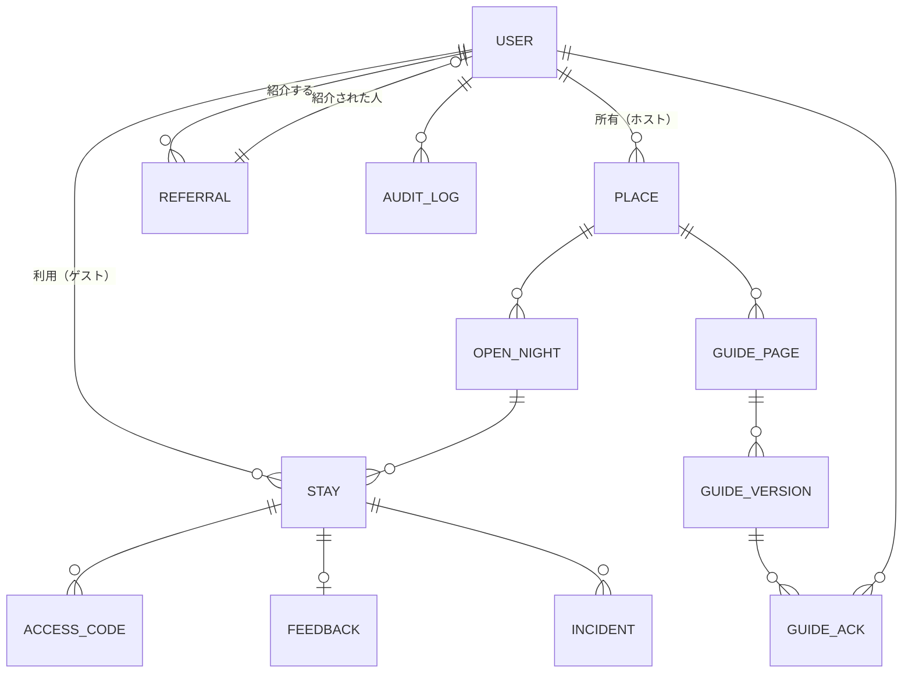
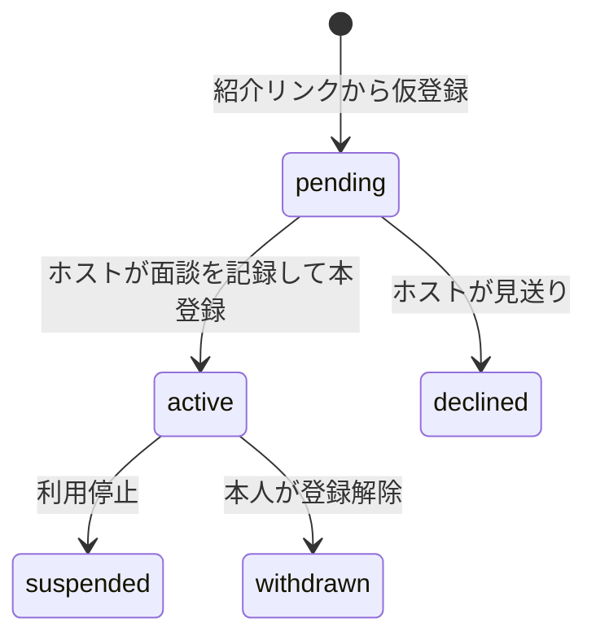
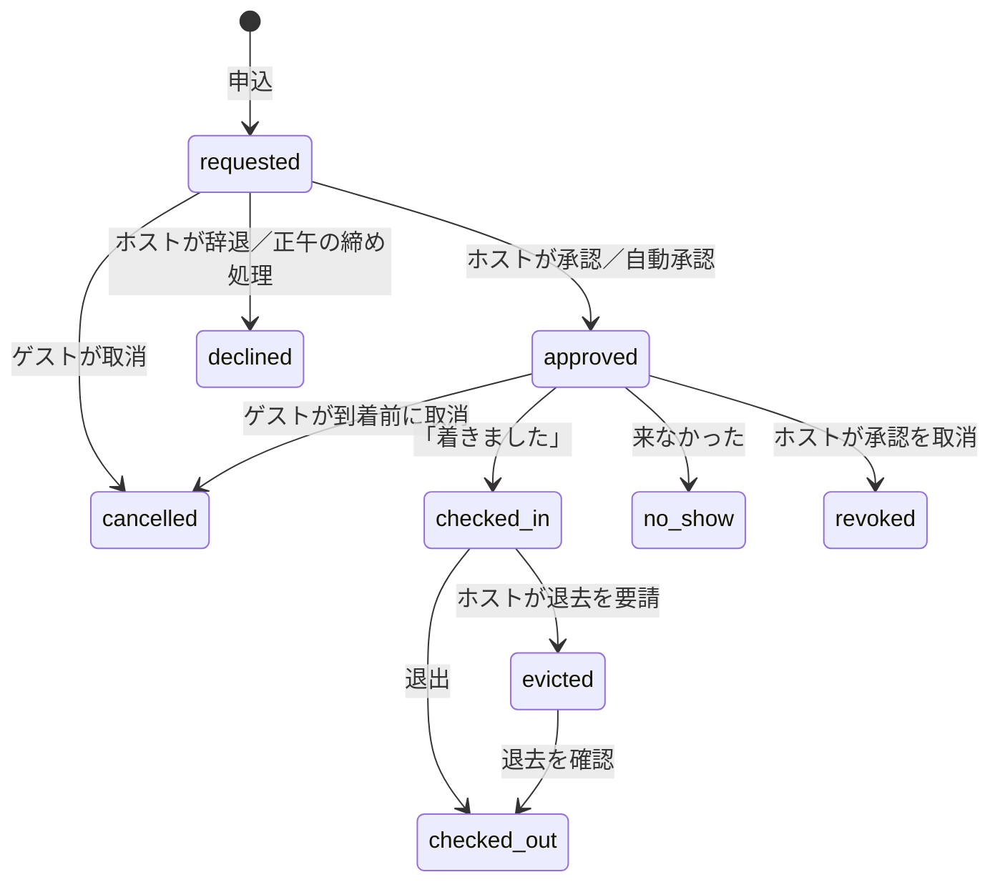
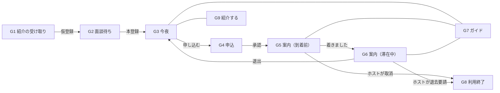

# 03. 設計書

| 項目 | 内容 |
|---|---|
| 版 | 1.0（2026-11-17） |
| 対象 | ステージ0：ホストの自宅 1 か所、完全紹介制、無償 |
| 関連文書 | [01 企画](01-concept.md)／[02 要件](02-requirements.md)／[04 鍵の選定](04-lock-selection.md)／[05 システム構成図](05-system-architecture.md)／[06 ホスティングの選定](06-hosting.md) |

要件の ID（F-xx、N-xx）は 02 を指す。「仮」と書いた値は未確定で、13 章にまとめる。外部サービスの仕様のうち実機・公式資料で確かめていないものは 15 章にまとめる。

## 1. 概要と方針

飲み会のあと、代行が来るまで、または朝まで、ホストの自宅の寝床とシャワーを、紹介と面談を経たゲストに無償で開放するための Web システム。

- **Web アプリ 1 本**。ゲストもホストも LINE 内のブラウザ（LIFF）から開く。専用アプリは作らない。
- **認証は LINE ログインのみ**。パスワードを持たない。
- **通知は LINE 公式アカウント**から送る。
- **サーバーは 1 台**。アプリ・DB・ジョブを同居させ、月 1,000 円程度で運用する。
- **入口は紹介だけ**。ホストが対面で面談した人だけを本登録にする。
- **ホストの決定が常に最優先**。どの状態からでも、ホストは理由なしに取消・退去要請・利用停止ができる。
- **証跡を残す**。同意・操作・鍵の発行を、変更できない形で記録する。
- **鍵は部品として切り離す**。SwitchBot を前提にするが、アダプター 1 か所の差し替えで他機種に移れるようにする。

## 2. システム構成

全体の図と流れは [05 システム構成図](05-system-architecture.md) を参照。

| 要素 | 採用 | 補足 |
|---|---|---|
| アプリ | Ruby on Rails 8 ＋ Hotwire | サーバー描画。画面の一部更新に Turbo を使う |
| DB | SQLite | 1 台で完結。ホストが複数になり同時書き込みが増えたら PostgreSQL に替える |
| ジョブ | Solid Queue | 通知の送信、定時処理、鍵の操作 |
| リッチテキスト・写真 | Action Text ＋ Active Storage（サーバーのディスク） | ガイドの編集、トラブル記録の写真 |
| 画面の入口 | LIFF | LINE の中で開く |
| 認証 | LINE Login | ID トークンをサーバーで検証 |
| 通知 | LINE Messaging API | プッシュ、ボタンつきメッセージ、Webhook |
| 鍵 | SwitchBot ロック ＋ キーパッド ＋ ハブ | クラウド API 経由。04 を参照 |
| サーバー | KAGOYA CLOUD VPS（メモリ 1GB） | 06 を参照 |
| 配置 | Kamal（Docker コンテナ 1 つ ＋ Kamal Proxy） | HTTPS の証明書は自動取得 |
| URL | 独自ドメインを推奨 | LIFF と Webhook は正規の証明書つき HTTPS が必須 |
| バックアップ先 | オブジェクトストレージ | DB と写真を 1 日 1 回 |
| 死活監視 | 外部の監視サービス | 停止時にホストへ知らせる |

## 3. 利用者と権限

| 利用者 | 説明 |
|---|---|
| ホスト | 自宅を開放する人。1 名。初期設定で登録した LINE アカウント 1 つだけに権限を与え、画面からは付与・変更できない |
| ゲスト | 紹介を受け、面談を経て本登録された人 |
| 仮登録の人 | 紹介リンクから仮登録し、面談を待っている人。面談待ちの画面しか開けない |

| 操作 | 仮登録の人 | ゲスト | ホスト |
|---|---|---|---|
| ガイドへの同意（面談時） | 可 | 可（再同意） | — |
| 開放状況・ガイドの閲覧 | 不可 | 可（ページの表示範囲による） | 可 |
| 申込、到着前の取消、到着・退出の記録 | 不可 | 自分の分のみ | 全員分を代行可 |
| 暗証番号の受け取り | 不可 | 承認済み・滞在中のみ | — |
| 紹介リンクの発行 | 不可 | ホストが許可したゲストのみ | 可 |
| 面談の記録、本登録、見送り | 不可 | 不可 | 可 |
| 紹介の可否・信頼済みの設定 | 不可 | 不可 | 可 |
| 承認、辞退、承認取消、退去要請、利用停止 | 不可 | 不可 | 可 |
| 開放の設定・締切・打ち切り、自動承認の切り替え | 不可 | 不可 | 可 |
| 解錠・施錠、鍵の状態確認 | 不可 | 不可 | 可 |
| ガイドの編集・公開、喫煙ルールの設定 | 不可 | 不可 | 可（公開済みの版は変更・削除不可） |
| 記録・監査ログ・面談メモの閲覧 | 不可 | 不可 | 可（監査ログは変更・削除不可） |

## 4. データ設計

### 4.1 全体

共通：全テーブルに `id`、`created_at`、`updated_at` を持つ。時刻は UTC で保存し、表示は日本時間。

### 4.2 users（利用者）

| 項目 | 型 | 内容 |
|---|---|---|
| line_user_id | 文字列・一意 | LINE のユーザー識別子 |
| line_display_name | 文字列 | LINE の表示名（ログインのたびに更新） |
| line_picture_url | 文字列 | LINE のアイコン |
| nickname | 文字列 | 呼び名。初期値は LINE の表示名 |
| role | host / guest | |
| status | pending / active / declined / suspended / withdrawn | 5.1 |
| referrer_id | users への参照 | 紹介者。ホスト自身が紹介した場合はホスト |
| can_refer | 真偽・既定は偽 | 紹介できるか。ホストが設定（F-02a） |
| interviewed_at | 日付 | 面談した日 |
| interview_checklist | JSON | 説明した項目のチェック |
| interview_memo | 文字列（暗号化） | 本名・連絡先など。ホストだけが読める |
| trusted_at / trusted_by | 日時 / 参照 | 信頼済み（自動承認の対象）。空なら対象外 |

### 4.3 referrals（紹介リンク）

| 項目 | 型 | 内容 |
|---|---|---|
| token | 文字列・一意 | 推測できない長さの乱数 |
| referrer_id | 参照 | 発行者 |
| candidate_user_id | 参照（空可） | 仮登録した人 |
| status | issued / used / expired / disabled | |
| expires_at / used_at | 日時 | 有効期限は発行から 7 日（仮） |

### 4.4 blocks（利用停止の名簿）

| 項目 | 型 | 内容 |
|---|---|---|
| line_user_id | 文字列・一意 | 停止した LINE アカウント |
| blocked_by / blocked_at | 参照 / 日時 | |
| memo | 文字列 | ホストのメモ |

users と分けて持ち、本人が登録解除しても残す。仮登録のたびに照合する（F-53）。

### 4.5 places（場所）

| 項目 | 型 | 内容 |
|---|---|---|
| host_id | 参照 | |
| name / address / lat / lng | | 住所は承認済みのゲストにだけ表示 |
| lock_adapter | switchbot / manual | manual は連携なし（ホストが手で開ける） |
| lock_config | JSON（暗号化） | SwitchBot のトークン、ロックとキーパッドの機器 ID |
| code_ttl_minutes | 整数・既定 30 | 暗証番号の有効時間 |
| smoking_policy | no_smoking / e_cig_only / outdoor_only | 未設定では開放できない（F-100） |
| default_sleep_slots / has_shower | 整数 / 真偽 | 開放設定の初期値 |
| default_accept_from / default_accept_until | 時刻 | 受付時間の初期値（仮：21:00〜翌 3:00） |
| trusted_accept_until | 時刻（空可） | 信頼済みゲスト向けの締切（F-98） |
| auto_approve_default | 真偽 | 自動承認の初期値 |
| auto_approve_only_when_empty | 真偽・既定は真 | ほかに滞在者がいるときは自動承認しない（F-97） |
| max_active_referrals | 整数（仮：2） | ゲスト 1 人が同時に持てる紹介リンク数（F-02c） |

ステージ0 は 1 件だけだが、ホスト拡大に備えて独立したテーブルにする（N-11）。

### 4.6 open_nights（夜ごとの開放）

| 項目 | 型 | 内容 |
|---|---|---|
| place_id, night_on | 参照, 日付・組で一意 | `night_on` は営業日（下記） |
| accept_from / accept_until | 日時 | 新規申込の受付時間 |
| ends_at | 日時 | 滞在の終了。翌 10:00 で固定 |
| sleep_slots / shower_available | 整数 / 真偽 | |
| auto_approve | 真偽 | その夜の自動承認 |
| status | open / closed / ended | 5.3 |
| host_memo | 文字列 | 負担メモ（F-64） |

**営業日**：滞在が翌朝 10:00 まで続くので、`night_on` は正午で切り替わる日付とする。金曜 23:00 の申込も土曜 9:00 の退出も、金曜の夜に属する。

### 4.7 stays（利用）

| 項目 | 型 | 内容 |
|---|---|---|
| open_night_id, guest_id | 参照 | 同じ夜に同じゲストの有効な利用は 1 件まで |
| wants_sleep / wants_shower | 真偽 | |
| eta | 日時 | 到着予定 |
| pickup_eta | 日時（空可） | 代行の到着見込み。空なら朝まで |
| note | 文字列 | 一言メモ |
| status | 5.2 の状態 | |
| approved_by | host / auto | |
| auto_approve_result | JSON | 自動承認の判定結果（外れた条件） |
| shower_state | none / using / done | |
| requested_at / decided_at / checked_in_at / checked_out_at / ended_by_host_at | 日時 | |

### 4.8 access_codes（暗証番号の発行記録）

| 項目 | 型 | 内容 |
|---|---|---|
| stay_id | 参照 | |
| code | 文字列（暗号化） | 暗証番号 |
| lock_key_id | 文字列 | SwitchBot 側の番号の ID |
| valid_from / valid_until | 日時 | 発行から 30 分 |
| status | requested / ready / failed / expired / delete_requested / deleted / delete_unconfirmed | 6.5 |
| first_shown_at | 日時 | ゲストの画面に初めて表示した時刻 |

### 4.9 ガイド

| テーブル | 項目 |
|---|---|
| guide_pages | place_id, title, position, topic（smoking / sleep / shower / toilet / rules / entry / other）, requires_ack, visibility（registered / approved_tonight）, draft_body, published_version_id, archived_at |
| guide_versions | guide_page_id, number, body, smoking_policy（喫煙ページのみ）, important, published_by, published_at |
| guide_acks | guide_version_id, user_id, kind（viewed / agreed）, occurred_at |

版と同意は追記のみ。ページの削除は `archived_at` を入れて非表示にするだけで、版と同意は残す。

### 4.10 記録

| テーブル | 項目 |
|---|---|
| incidents | stay_id, kind（smoking / other）, body, 写真（添付）, created_by |
| feedbacks | stay_id, helped（真偽）, comment |
| audit_logs | occurred_at, actor_id（空ならシステム）, action, stay_id, open_night_id, target_user_id, detail（JSON） |

`audit_logs` は追記のみ。アプリに更新・削除の経路を作らず、DB のトリガーでも UPDATE・DELETE を拒否する（F-60）。

## 5. 状態遷移

### 5.1 利用者（users.status）

### 5.2 利用（stays.status）

### 5.3 夜（open_nights.status）

| 状態 | 意味 | 移り方 |
|---|---|---|
| open | 受付中 | ホストが開放を設定 |
| closed | 受付終了。承認済みの利用は続く | ホストが締め切る／受付時間が過ぎる／ホストが打ち切る |
| ended | 終了 | 正午の締め処理 |

## 6. 機能設計

### 6.1 紹介・面談・登録（F-01〜F-10d）

1. **紹介**：ホスト、または `can_refer` が真のゲストが、紹介リンクを発行して LINE で送る。リンクは 1 人 1 回限りで、有効期限がある。発行のたびに `can_refer` と、有効なリンク数が `max_active_referrals` 未満であることを確認する。
2. **仮登録**：相手がリンクを開き、「仮登録」を押す。`blocks` に載っていなければ `status = pending` の利用者を作り、公式アカウントを友だちに追加し、ホストに通知する。
3. **面談**：ホストが対面で会う。相手は自分のスマホの面談待ち画面で、喫煙ルールと、同意が必要なガイドを読んで同意する。喫煙ルールへの同意は別のボタンで取る（F-103）。
4. **本登録**：ホストが面談日とチェック項目を入れ、「本登録にする」を押す。`interviewed_at` と必要な同意がそろっていなければ拒否する（F-06、F-07）。
5. **見送り**：ホストは理由なしに `declined` にできる。本人と紹介者には結果だけを通知する。

- 入口は紹介リンクだけ。誰でも読み取れる QR カードや、複数人が使える共通のリンクは作らない。
- 面談メモはホストだけが読める。ゲスト側の画面・通知には出さない。
- `can_refer` を偽にした時点で、そのゲストが発行した未使用のリンクを `disabled` にする。
- 紹介のつながりは `referrer_id` をたどって表示する。ホストは、あるゲストが紹介した人をまとめて利用停止にできる（F-54）。
- 紹介者に見せるのは、紹介した相手の状態（面談待ち／登録済み／見送り）まで。
- 日程の調整はシステムで扱わず、LINE の直接のやり取りで行う。

### 6.2 開放設定（F-10〜F-13）

- ホストが夜ごとに、受付時間・寝床の数・シャワーの可否・自動承認の有無を設定して開放する。初期値は場所の設定から入れる。
- `smoking_policy` が未設定なら、開放を拒否する。
- 開放すると、全ゲストに通知する（F-13）。
- ホストは受付を締め切れる（承認済みの利用は続く）。打ち切りは 6.7。

### 6.3 申込・承認（F-20〜F-25）

- 申込の条件：本登録済み／その夜が `open` で受付時間内／同じ夜に有効な利用がない／再同意が必要なガイドがない。
- 入力は選択式：到着予定（今すぐ・30 分後・1 時間後）、希望（寝床・シャワー・両方）、代行の見込み（1 時間後・2 時間後・朝まで）、任意の一言。
- 申込ボタンのすぐ上に喫煙ルールを表示し、ボタンの文言を「喫煙ルールを守って申し込む」にする（F-104）。
- **定員**：承認時に、同じ夜の `approved`・`checked_in` のうち寝床希望の件数を数え、`sleep_slots` 未満のときだけ承認する。数える処理と更新は 1 つのトランザクションで行う。シャワーのみの利用は数えない。
- ホストは LINE の通知のボタン、または管理画面から承認・辞退する。

### 6.4 自動承認（F-90〜F-99）

申込を保存した直後に、承認と同じトランザクションの中で判定する。次をすべて満たせば `approved`・`approved_by = auto` にする。

1. ゲストが信頼済みで、利用停止でない
2. その夜の `auto_approve` が真
3. 受付時間内（`trusted_accept_until` があれば、信頼済みゲストにはそれを使う）
4. 寝床希望の場合、定員に空きがある
5. 再同意が必要なガイドがない
6. 鍵の連携が有効（`lock_adapter = switchbot`）
7. `auto_approve_only_when_empty` が真の場合、同じ夜に `approved`・`checked_in` の利用がほかにない

- 満たさなければ `requested` のまま残し、外れた条件を添えてホストに通知する。判定結果は `auto_approve_result` と監査ログに残す。
- 自動承認の通知は、音の鳴らない指定でホストに送る。「取り消す」ボタンを付ける。
- 信頼済みの設定・解除はホストだけ。利用停止、または喫煙の違反を記録したときは自動で解除する。
- 夜ごとのスイッチを切ると、以後の申込はすべてホストの承認待ちになる。自動承認済みの利用には影響しない。

### 6.5 入室と鍵（F-30〜F-35）

**暗証番号（主）**：承認時には番号を出さない。ゲストが玄関の前で「着きました」を押すたびに、30 分だけ有効な番号を発行する。

1. ゲストが「着きました」を押す。利用が `approved` または `checked_in` で、その夜が終了していないことを確認する。初回なら `checked_in` にして到着時刻を記録する。
2. 乱数で番号を作り、`access_codes` を `requested` で保存し、鍵アダプターに発行を依頼する（ジョブ）。
3. 画面には「準備中」を出す。鍵に届いたことを確認できたら `ready` にして番号と残り時間を表示する。一定時間たっても確認できなければ `failed` にして、「ホストに開けてもらう」を案内する。
4. 外出して戻るときは、もう一度押して新しい番号を受け取る。前の番号は期限で切れる。
5. 期限を過ぎた番号は `expired` にする。

**遠隔解錠（補助）**：番号で開かないとき、ゲストが「ホストに開けてもらう」を押す。ホストに「解錠」ボタンつきの通知が届き、押すとアダプターが解錠する。解錠できるのはホストだけ。

**鍵アダプター**：鍵の操作を次の 5 つにまとめる。

| 操作 | SwitchBot での実現 |
|---|---|
| 番号の発行 | キーパッドに、開始・終了時刻つきの番号を登録する |
| 番号の削除 | キーパッドから番号を削除する |
| 番号の一覧 | キーパッドに登録されている番号を読み出す |
| 解錠・施錠 | ロックに命令を送る |
| 状態の取得 | ロックの施錠状態を読み出す |

`lock_adapter = manual` のときは、発行・解錠を行わず、「ホストに開けてもらう」だけを出す。障害時や機器の入れ替え中に使う。

**取消時の扱い**：SwitchBot には番号の削除が効かないという報告がある（04 の 3 章）。そのため、取消の実効性は「以後発行しない」ことと「30 分で切れる」ことで確保する。削除も呼び、番号の一覧を読み直して確認する。残っていれば `delete_unconfirmed` にしてホストに通知する。

### 6.6 滞在・退出・朝の処理（F-40〜F-45）

- ゲストは「退出」を押す。ホストも代わりに記録できる。退出時にホストへ通知する。
- シャワーは「使用中／空き」をゲストが切り替え、ほかの滞在者の画面にも反映する。
- 代行の到着見込みの 10 分前に、ゲストに知らせる。
- 9:30 に滞在中のゲストへ、10:00 までに退出するよう知らせる。10:00 に、残っているゲストをホストに知らせる。10:00 を過ぎても自動では退出扱いにせず、ホストが確認して記録する。
- 正午に、その夜を `ended` にし、`requested` のままの申込を `declined` にする。
- 到着予定を大きく過ぎた承認済みの利用を、ホストが `no_show` にできる。

### 6.7 ホストの権限（F-50〜F-58）

| 操作 | 対象 | 結果 |
|---|---|---|
| 承認の取消 | `approved` の利用 | `revoked` |
| 退去の要請 | `checked_in` の利用 | `evicted`。ホストが退去を確認して `checked_out` |
| 利用停止 | ゲスト | `suspended`。`blocks` に追加。進行中の利用を状態に応じて `declined`・`revoked`・`evicted` にする。信頼済みと紹介の権限を解除 |
| まとめて利用停止 | あるゲストが紹介した人 | 上と同じ処理を全員に行う |
| 開放の打ち切り | その夜 | `closed`。未承認の申込はすべて `declined`。滞在中・承認済みのゲストに通知 |

- いずれも理由の入力を求めず、確認 1 回で実行する。
- 実行と同時に、暗証番号の発行停止、発行済み番号の削除、案内画面の非表示、ゲストへの通知、監査ログへの記録を行う。
- 対象のゲストには、案内画面の代わりに「この利用は終了しました」を表示する。理由は出さず、異議を出す手段も置かない（F-57）。
- トラブルの記録は、区分（喫煙の違反／その他）、メモ、写真。喫煙の違反は 1 操作で記録できる。

### 6.8 ガイド（F-70〜F-80）

寝具・シャワー・トイレの使い方、ハウスルール、入り方の説明を、同じ仕組みの「ページ」として扱う。初期状態で、喫煙ルール・寝具・シャワー・トイレ・ハウスルールの 5 ページを用意する。

- **編集**：Action Text で、見出し・太字・箇条書き・番号つきリスト・リンク・写真を見たままの形で編集する。スマホから編集でき、撮った写真を入れられる。写真は表示用に縮小する。本文は許可した要素だけを残す。
- **下書きと公開**：編集内容は `draft_body` に自動保存する。「公開」で新しい版を作り、`published_version_id` を付け替える。公開時に「重要な変更」かどうかを選ぶ。過去の版に戻すときは、その内容で新しい版を作る。
- **同意**：`requires_ack` のページは、面談時に同意を取る。同意の後に「重要な変更」の版が公開されたら、次の申込の前に再同意を求める。誤字などの軽微な修正では求めない。
- **周知**：承認の通知と案内画面から開ける。案内画面では、希望に合うページ（寝床なら寝具、シャワーならシャワー）を先に並べる。重要な変更は全ゲストに通知する。
- **既読と同意の記録**：ページを開いたら `viewed`、同意したら `agreed` を版つきで記録する。
- **表示の範囲**：`registered` は本登録済みの全ゲスト、`approved_tonight` は承認されたゲストにその夜だけ。場所が分かる内容や外観の写真は後者にする。
- 住所と暗証番号はガイドの本文に書かず、専用の項目で管理する。取消時に確実に隠すため。

### 6.9 喫煙ルール（F-100〜F-110）

- 場所ごとに喫煙ルールのページを 1 つ、システムが必ず作る。`requires_ack` は常に真、表示範囲は常に `registered`。ホストは削除・非表示・同意不要への変更ができない。
- 見出し部分は `smoking_policy` から自動で作る。ホストが編集できるのは、その下の補足だけ。

| 設定 | 表示する定型文 |
|---|---|
| `no_smoking` | 完全禁煙。室内・ベランダ・敷地内のどこでも、紙巻き・加熱式・電子タバコすべて不可 |
| `e_cig_only` | 加熱式・電子タバコのみ可。紙巻きたばこは不可 |
| `outdoor_only` | 喫煙はベランダ・屋外でのみ可。室内は不可 |

- 定型文には、火災の危険と、違反した場合は退去を求めて以後の利用を断ることを併記する。
- 表示は共通の部品 1 つにし、面談時・今夜・申込・案内（到着前・滞在中）・ガイドのルールページの先頭に同じ見た目で出す。承認の通知には 1 行で入れる。
- `smoking_policy` を変えると、新しい版を必ず「重要な変更」として公開する。全ゲストへの通知と再同意が自動で起きる。
- トラブル記録で喫煙の違反を選ぶと、そのゲストの信頼済みを解除する。

### 6.10 記録（F-60〜F-65）

- 監査ログに残す操作：仮登録、面談の記録、本登録・見送り、紹介の可否と信頼済みの変更、開放の設定・締切・打ち切り、申込、承認・辞退・自動承認の判定、暗証番号の発行・表示・削除の結果、解錠・施錠、到着・退出、承認取消・退去要請・利用停止、ガイドの公開、喫煙ルールの変更。
- 記録画面：月ごとの利用一覧、集計（利用回数、平均滞在、自動承認の件数、トラブルの件数）、操作ログ、アンケート、負担メモ。
- 書き出し：ある利用、またはあるゲストについて、利用・同意・操作ログ・トラブル記録の一式を出す（F-65、F-110）。
- 退出の当日夕方に、一言アンケートを送る。

## 7. 画面設計

### 7.1 画面一覧

| # | 画面 | 利用者 | 主な内容 |
|---|---|---|---|
| G1 | 紹介の受け取り | 未登録の人 | 紹介者、使えるようになるまでの手順、「仮登録する」 |
| G2 | 面談待ち・面談での同意 | 仮登録の人 | 面談待ちの表示。面談時は喫煙ルールとガイド、同意ボタン |
| G3 | 今夜 | ゲスト | 開放状況、受付時間、寝床の残り、シャワー、喫煙ルール、「申し込む」。申込後は自分の利用の状態 |
| G4 | 申込 | ゲスト | 選択式の入力、喫煙ルール、「喫煙ルールを守って申し込む」 |
| G5 | 案内（到着前） | 承認済みのゲスト | 住所、地図、入り方、喫煙ルール、ガイド、「着きました」、申込の取消 |
| G6 | 案内（滞在中） | 滞在中のゲスト | 暗証番号と残り時間、出し直し、「ホストに開けてもらう」、ガイド、シャワー、「退出する」 |
| G7 | ガイド | ゲスト | ページの切り替え、本文。ルールページの先頭に喫煙ルール。再同意の案内 |
| G8 | 利用終了 | 取消・退去要請・利用停止を受けたゲスト | 終了の表示、退出の案内、「退出しました」 |
| G9 | 紹介する | 紹介を許可されたゲスト | 紹介リンクの送信、残りの本数、紹介した人の状態 |
| H1 | 今夜の管理 | ホスト | 開放の設定・締切・打ち切り、鍵の状態と解錠、自動承認の切り替え、申込の承認・辞退、滞在中のゲストへの操作 |
| H2 | ゲスト管理 | ホスト | 面談待ちの一覧、面談の記録と本登録・見送り、紹介リンクの発行、ゲスト一覧、紹介の可否、信頼済み、利用停止 |
| H3 | ガイド編集 | ホスト | ページの追加・並べ替え、編集、プレビュー、公開、同意の要否と表示範囲、過去の版 |
| H4 | 喫煙ルールの設定 | ホスト | 3 択、補足、ゲストへの表示の見本、掲示の印刷 |
| H5 | 記録 | ホスト | 利用一覧、集計、操作ログ、アンケート、負担メモ、書き出し |

画面の見本は、別に作成した画面モックを参照する。

### 7.2 ゲストの画面の遷移

### 7.3 使いやすさの決まり

- ゲストの主経路（今夜 → 申込 → 案内）は、開いてから申込完了まで 3 操作以内（N-03）。
- 入力は選択式にして、文字入力を任意の一言だけにする。
- ボタンは大きく、配色は夜に見やすい暗い色にする。
- 状態が変わる画面（今夜、案内、今夜の管理）は、開いたままでも自動で更新する。

## 8. 通知設計

| きっかけ | 宛先 | 内容 | 音 |
|---|---|---|---|
| 仮登録があった | ホスト | 誰の紹介で誰が仮登録したか | あり |
| 本登録にした・見送った | 本人、紹介者 | 結果だけ | あり |
| 開放を設定した | 全ゲスト | 今夜開放していること、受付時間 | あり |
| 申込があった | ホスト | 申込内容、初回かどうか、紹介者、「承認」「辞退」ボタン | あり |
| 自動承認した | ホスト | 誰を自動承認したか、申込内容、「取り消す」ボタン | なし |
| 自動承認の条件から外れた | ホスト | 通常の申込通知に、外れた理由を添える | あり |
| 承認・辞退した | ゲスト | 結果。承認時は喫煙ルール（1 行）、案内とガイドへのリンク | あり |
| ゲストが取り消した | ホスト | 誰が取り消したか | あり |
| 「着きました」が押された | ホスト | 誰が着いたか | なし |
| 「ホストに開けてもらう」が押された | ホスト | 誰が待っているか、「解錠」ボタン | あり |
| 解錠した | ゲスト | 鍵が開いたこと | あり |
| 番号の発行に失敗した | ホスト | 誰の番号が発行できなかったか | あり |
| 削除した番号が残っている | ホスト | 対象と、期限で切れる時刻 | あり |
| 代行の到着見込みの 10 分前 | ゲスト | そろそろ代行が来る時刻であること | あり |
| 退出した | ホスト | 誰が退出したか、残りの滞在者数 | なし |
| 承認を取り消した・退去を要請した・利用停止にした | ゲスト | 利用が終了したこと。理由は書かない | あり |
| 開放を打ち切った | 滞在中・承認済みのゲスト | 今夜の開放が終了したこと | あり |
| 9:30 | 滞在中のゲスト | 10:00 までに退出すること | あり |
| 10:00 | ホスト | まだ滞在中のゲストの一覧 | あり |
| ガイドの重要な変更・喫煙ルールの変更を公開した | 全ゲスト | 変更したページ名とリンク。次の申込時に再同意となること | あり |
| 退出の当日夕方 | 利用したゲスト | 一言アンケートへのリンク | なし |

- 通知には住所と暗証番号を書かない。どちらも案内画面でのみ表示する。
- 通知の送信はジョブで行い、失敗したら再試行する。再試行しても送れなかった通知は記録画面に出す。

## 9. 外部連携

### 9.1 LINE

| 機能 | 使い方 |
|---|---|
| LIFF | すべての画面を LINE 内で開く。LIFF から ID トークンを受け取る |
| LINE Login | ID トークンをサーバーから LINE に送って検証し、ユーザー識別子・表示名・アイコンを得る。仮登録と同時に公式アカウントを友だちに追加する |
| Messaging API（プッシュ） | 8 章の通知を送る。音なしの通知は、通知を無効にする指定をつけて送る |
| Messaging API（ボタン） | 承認・辞退・取り消す・解錠のボタン。押されると Webhook が届く |
| Webhook | 署名を検証する。ボタンの操作者がその場所のホストであることを確認してから処理する。同じ操作が 2 度届いても 1 度だけ処理する |

Messaging API の無料枠には月間の送信数上限がある。Webhook への応答として返すメッセージは上限に数えられないので、ボタン操作への返事は応答で返す。全ゲストへの一斉通知は人数分を消費するので、ゲストが増えたら見直す。

### 9.2 SwitchBot

| 操作 | 使い方 |
|---|---|
| 認証 | トークンと署名をリクエストに付ける。認証情報は暗号化して保存する |
| 番号の発行 | キーパッドに、期限つきの番号を登録する命令を送る。開始・終了時刻を指定する |
| 番号の一覧・削除 | 発行の確認と、取消後の確認に使う |
| 解錠・施錠・状態 | ロックに命令を送り、状態を読み出す |

- 命令は「送った」ことが返るだけで、機器が実行したかは分からない。発行の後は一覧を読み直して確認する。
- API の呼び出しは 1 日 10,000 回まで。管理画面の鍵の状態は、開いたときと操作の後にだけ取得し、常時の問い合わせはしない。
- 呼び出しが失敗したら、間隔を空けて数回まで再試行する。それでも失敗したら、ホストに通知し、ゲストには「ホストに開けてもらう」を案内する。

## 10. 定時処理とジョブ

| 処理 | 時機 | 内容 |
|---|---|---|
| 受付の締切 | 毎分 | 受付時間を過ぎた夜を `closed` にする |
| 代行の知らせ | 毎分 | `pickup_eta` の 10 分前になった滞在中のゲストに通知 |
| 番号の期限切れ | 毎分 | 期限を過ぎた番号を `expired` にする |
| 朝の知らせ | 9:30 | 滞在中のゲストに通知 |
| 残留の知らせ | 10:00 | 残っているゲストをホストに通知 |
| 夜の締め | 正午 | 夜を `ended` に、未承認の申込を `declined` にする |
| アンケート | 夕方 | その日に退出したゲストに送る |
| 紹介リンクの期限切れ | 1 日 1 回 | 期限を過ぎたリンクを `expired` にする |
| バックアップ | 1 日 1 回 | DB と写真をバックアップ先に送る |
| 通知の送信 | 随時 | LINE への送信と再試行 |
| 鍵の操作 | 随時 | 番号の発行・確認・削除、解錠・施錠 |

## 11. セキュリティ

- **認証**：ID トークンをサーバーで検証し、セッションを発行する。セッションの Cookie は HTTPS のみ・スクリプトから読めない設定にする。
- **状態の確認**：リクエストのたびに利用者の `status` を確認する。利用停止は、相手が画面を開いたままでも次の操作から効く。本登録でない利用者は面談待ちの画面以外を開けない。
- **ホスト権限**：初期設定の LINE アカウント 1 つだけ。画面から付与・変更する機能を作らない。
- **住所と暗証番号**：案内画面は、本人の利用が `approved` または `checked_in` で、その夜が終了していないときだけ表示する。通知・ガイド・ログの本文には書かない。
- **暗号化**：暗証番号、面談メモ、SwitchBot の認証情報は暗号化して保存する。
- **紹介リンク**：推測できない長さの乱数。1 回限り、期限つき。
- **Webhook**：署名を検証する。
- **入力**：ガイドの本文は許可した要素だけを残す。写真は種類と大きさを制限する。
- **サーバー**：SSH は鍵認証のみ。外に開けるのは 22・80・443 番だけ。OS の更新を自動で当てる。
- **個人情報**：保存するのは LINE の識別子・表示名・アイコン、利用記録、ホストが控えた面談メモ。本人が登録解除しても、利用記録・監査ログ・利用停止の情報は保持する。この扱いはハウスルールに書き、同意を取る（N-08）。

## 12. 運用

- **配置**：Kamal で、手元から 1 コマンドで入れ替える。DB と写真はコンテナの外のディスクに置き、入れ替えで消えないようにする。
- **バックアップ**：1 日 1 回、DB の複製と写真をバックアップ先に送る。復元の手順を試行の開始前に 1 度実際に行う。
- **死活監視**：外部の監視サービスから定期的に確認用の URL を呼び、応答がなければホストに知らせる。
- **障害時**：

| 止まったもの | 代替 |
|---|---|
| サーバー | LINE で直接やり取りし、ホストが SwitchBot アプリで解錠する。記録は後からホストが手入力する |
| LINE | 電話などで連絡し、ホストが SwitchBot アプリで解錠する |
| SwitchBot・宅内 Wi-Fi | `lock_adapter` を `manual` に切り替え、ホストが玄関で開ける |
| 鍵の電池切れ | 物理の鍵で開ける。電池残量を定期的に確認する |

## 13. 設定値

| 項目 | 値 | 確定 |
|---|---|---|
| 滞在の終了 | 翌 10:00 | 確定 |
| 営業日の切り替え | 正午 | 確定 |
| 寝床の数 | 2 | 確定 |
| 暗証番号の有効時間 | 30 分 | 確定（短縮も可） |
| 受付時間 | 21:00〜翌 3:00 | 仮 |
| 朝の知らせ | 9:30 | 確定 |
| 代行の知らせ | 見込みの 10 分前 | 仮 |
| 紹介リンクの有効期限 | 7 日 | 仮 |
| ゲスト 1 人の紹介リンクの上限 | 2 本 | 仮 |
| ほかに滞在者がいるときは自動承認しない | 有効 | 仮 |
| 喫煙ルールの「電子タバコのみ可」 | 加熱式・電子は室内で可、紙巻きは不可 | 仮 |

## 14. 実装の順序

1. LINE ログイン、紹介、仮登録、面談の記録と本登録、利用停止の照合
2. ガイドの編集・公開・同意、喫煙ルール
3. 開放設定、今夜の表示、申込、承認、案内
4. 鍵の連携（番号の発行と確認、遠隔解錠）、到着・退出
5. 通知、定時処理、監査ログ
6. ホストの権限（承認取消、退去要請、利用停止、打ち切り）、記録
7. 自動承認、紹介の可否の設定

3 までは鍵を `manual` にして進められる。4 は SwitchBot の実機が届いてから行う。

## 15. 未確定・要検証

| 項目 | 内容 | 確かめる方法 |
|---|---|---|
| SwitchBot の番号の発行 | 発行から使えるようになるまでの時間、期限切れの番号で開かないこと | 実機（04 の 4 章） |
| SwitchBot の番号の削除 | 削除が効くか | 実機 |
| SwitchBot の番号の桁数・入力手順 | 画面の案内文に反映する | 実機 |
| SwitchBot の自動施錠 | 扉が閉まると自動で施錠されるか | 実機 |
| Wi-Fi・ハブの停止時 | 発行済みの番号で入れるか | 実機 |
| LINE Messaging API の無料枠 | 月間の送信数上限 | 公式の料金表 |
| KAGOYA CLOUD VPS | 1GB プランの月額、Docker と Kamal が動くこと | 公式の料金表、契約後の確認 |
| 仮の設定値 | 13 章で「仮」としたもの | ホストの判断 |
