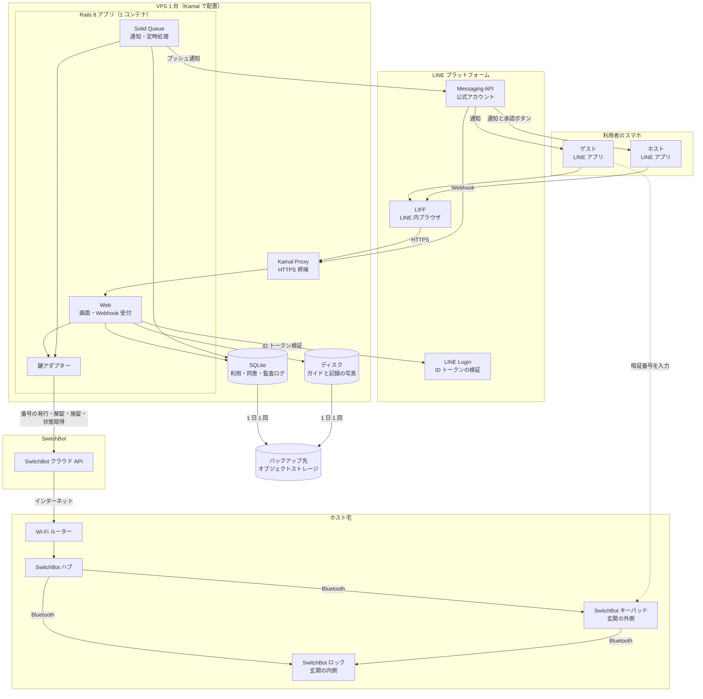
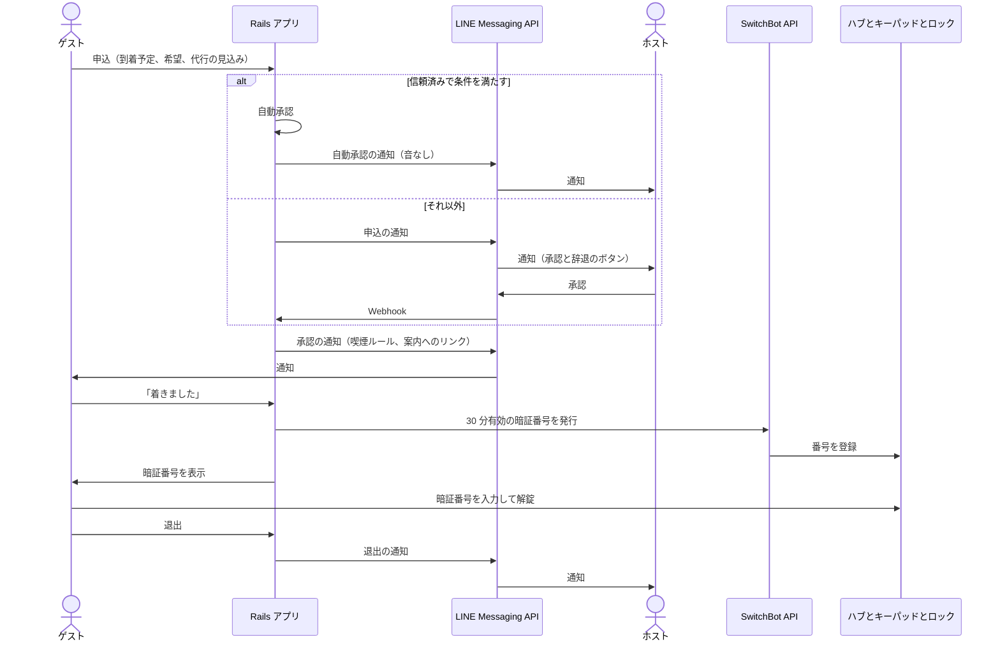
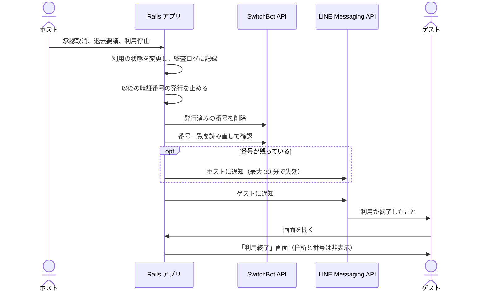

# 05. システム構成図

ステージ0（自宅 1 か所・SwitchBot 前提）の構成。設計の詳細は [03-system-design.md](03-system-design.md)、鍵の選定は [04-lock-selection.md](04-lock-selection.md)。

## 1. 全体構成

## 2. 構成要素

| 区分 | 要素 | 役割 |
|---|---|---|
| 利用者 | ゲスト・ホストのスマホ | LINE アプリだけで使う。専用アプリは入れない |
| LINE | LIFF | LINE の中で Web 画面を開く。ログイン操作が要らない |
| LINE | LINE Login | 利用者の特定（LINE のユーザー識別子） |
| LINE | Messaging API | 通知の送信、承認・解錠ボタンの操作の受け取り（Webhook） |
| サーバー | Kamal Proxy | HTTPS の終端、無停止での入れ替え |
| サーバー | Rails アプリ（Web） | 画面、申込・承認・自動承認の判定、ガイドの編集、権限の確認 |
| サーバー | Solid Queue | 通知の送信、朝 9:30・10:00・正午の定時処理、番号の発行と確認 |
| サーバー | 鍵アダプター | 鍵の操作を 1 か所にまとめる部品。機種を替えるときはここだけ差し替える |
| サーバー | SQLite | 利用者、開放、利用、ガイドの版と同意、監査ログ |
| サーバー | ディスク | ガイドとトラブル記録の写真 |
| 外部 | バックアップ先 | DB と写真の複製を 1 日 1 回保管 |
| 鍵 | SwitchBot クラウド API | 番号の発行、解錠・施錠、状態取得の窓口 |
| ホスト宅 | Wi-Fi ルーター・ハブ | クラウドからの命令を鍵とキーパッドに中継 |
| ホスト宅 | ロック・キーパッド | 玄関の施錠・解錠、暗証番号の入力 |

## 3. 主な流れ

### 申込から入室まで

### ホストによる取消・退去要請

## 4. 障害時の動き

| 止まったもの | 影響 | 代替 |
|---|---|---|
| サーバー（VPS） | 申込・承認・番号の発行ができない | LINE で直接やり取りし、ホストが SwitchBot アプリで解錠する |
| LINE | 画面を開けず、通知も届かない | 電話などで連絡し、ホストが SwitchBot アプリで解錠する |
| SwitchBot クラウド・ハブ・宅内 Wi-Fi | 新しい番号の発行と遠隔の解錠ができない | ホストが玄関で直接開ける。発行済みの番号が使えるかは実機で確認する（04 の 4 章） |
| キーパッド・ロックの電池切れ | 暗証番号でも遠隔でも開かない | 物理の鍵で開ける。電池残量を定期的に確認する |
